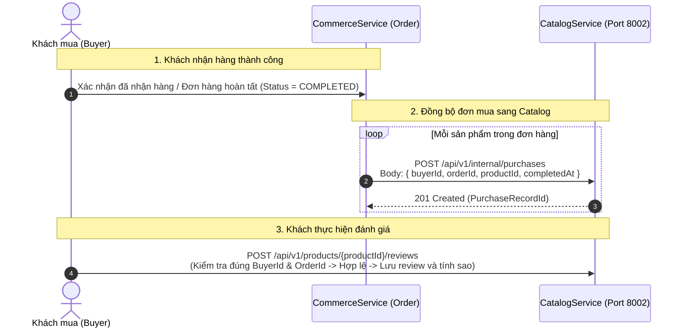

# HƯỚNG DẪN TÍCH HỢP ĐỒNG BỘ ĐƠN MUA HÀNG (PURCHASE RECORD SYNC)
## COMMERCE SERVICE ➔ CATALOG SERVICE

> **Dự án:** Nexus Microservices Ecosystem  
> **Service gửi:** `CommerceService` / `OrderService` (Quản lý Đơn hàng & Thanh toán)  
> **Service nhận:** `CatalogService` (Port `8002` - Quản lý Sản phẩm & Đánh giá)  
> **Mục đích:** Đồng bộ thông tin đơn hàng đã giao thành công sang CatalogService để **kích hoạt quyền đánh giá (Verified Purchase Review)** cho Buyer.  
> **Ngày ban hành:** 10/11/2026  
> **Trạng thái:** ✅ SẴN SÀNG GỌI NGAY  

---

## 1. Bối cảnh & Nguyên lý Nghiệp vụ

Để đảm bảo tính trung thực và ngăn chặn review giả mạo (Fake/Spam Reviews), hệ thống áp dụng cơ chế **Xác thực Mua hàng (Verified Purchase)**:
- Người dùng chỉ được phép gửi đánh giá cho sản phẩm khi họ **thực sự đã mua sản phẩm đó trong một đơn hàng hoàn tất** (`PurchaseRecord` tồn tại trong CatalogService).
- Khi khách hàng nhận hàng thành công (đơn hàng chuyển sang trạng thái `COMPLETED` hoặc `DELIVERED`), CommerceService có trách nhiệm thông báo sang CatalogService bản ghi hoàn tất này.



---

## 2. Thông tin Kỹ thuật của Endpoint

- **HTTP Method:** `POST`
- **Đường dẫn URL:**
  - Trong mạng nội bộ Docker / Kubernetes: `http://catalog-service:8002/api/v1/internal/purchases`
  - Chạy local dev / Kestrel: `http://localhost:8002/api/v1/internal/purchases`
- **Xác thực (Auth):** `AllowAnonymous` / Nội bộ (Không yêu cầu JWT User, giao tiếp trực tiếp Service-to-Service).
- **Headers:**
  ```http
  Content-Type: application/json
  Accept: application/json
  ```

---

## 3. Cấu trúc Dữ liệu Yêu cầu (Request Contract)

### 3.1. JSON Request Body
```json
{
  "buyerId": "dddddddd-4444-4444-4444-444444444444",
  "orderId": "99000000-0000-0000-0000-000000000002",
  "productId": "11000000-0000-0000-0000-000000000001",
  "completedAt": "2026-11-10T07:30:00Z"
}
```

### 3.2. Bảng Mô tả Thuộc tính
| Thuộc tính | Kiểu dữ liệu | Bắt buộc | Mô tả & Lưu ý |
| :--- | :---: | :---: | :--- |
| `buyerId` | `UUID` (string) | **Có** | ID của người mua hàng (tài khoản đã đặt đơn hàng này). |
| `orderId` | `UUID` (string) | **Có** | ID của đơn hàng (Sub-order hoặc Order ID hoàn tất). |
| `productId` | `UUID` (string) | **Có** | ID của sản phẩm trong đơn hàng. *(Lưu ý: Truyền đúng `productId`, không truyền `variantId`)*. |
| `completedAt` | `DateTimeOffset` (ISO 8601) | Không | Thời điểm đơn hàng hoàn tất. Nếu bỏ trống, CatalogService sẽ tự động lấy thời gian UTC hiện tại. |

---

## 4. Cấu trúc Dữ liệu Phản hồi (Response Contract)

### 4.1. Phản hồi thành công
- **HTTP Status:** `201 Created` (nếu tạo mới) hoặc `200 OK` (nếu bản ghi đã tồn tại trước đó).
- **JSON Body:**
```json
{
  "id": "33400000-0000-0000-0000-000000000001",
  "buyerId": "dddddddd-4444-4444-4444-444444444444",
  "orderId": "99000000-0000-0000-0000-000000000002",
  "productId": "11000000-0000-0000-0000-000000000001",
  "completedAt": "2026-11-10T07:30:00Z",
  "createdAt": "2026-11-10T07:30:01Z"
}
```

### 4.2. Cơ chế An toàn & Chống trùng lặp (Idempotency)
- API được thiết kế **100% Idempotent**. 
- Nếu vì lý do mạng chập chờn hoặc retry mechanism của CommerceService gửi lại cùng một bộ `(buyerId, orderId, productId)` nhiều lần:
  - CatalogService sẽ **không tạo bản ghi duplicate**.
  - CatalogService trả về thông tin bản ghi đã có với mã `200 OK` an toàn tuyệt đối.

---

## 5. Bảng Mã Lỗi (RFC 9110 Error Matrix)

Khi xảy ra lỗi, CatalogService sẽ trả về chuẩn RFC 9110 Problem Details:

| HTTP Status | Error Code | Nguyên nhân kích hoạt | Hướng xử lý phía Commerce |
| :---: | :--- | :--- | :--- |
| `400 Bad Request` | `VAL_INVALID_INPUT` | Một trong các trường `buyerId`, `orderId`, `productId` bị để trống hoặc sai định dạng UUID. | Kiểm tra lại dữ liệu đầu vào trước khi gọi. |
| `404 Not Found` | `PRODUCT_NOT_FOUND` | `productId` không tồn tại trong Catalog (hoặc đã bị xóa hẳn). | Log cảnh báo để kiểm tra lại tính toàn vẹn dữ liệu giữa hai hệ thống. |
| `500 Internal Error`| `INTERNAL_SERVER_ERROR` | Sự cố kết nối CSDL hoặc lỗi hệ thống Catalog. | Thực hiện cơ chế Retry có Exponential Backoff. |

---

## 6. Đoạn Mã Mẫu Tích hợp (Code Examples)

### 6.1. C# (.NET HttpClient)
```csharp
public class CatalogSyncClient
{
    private readonly HttpClient _httpClient;

    public CatalogSyncClient(HttpClient httpClient)
    {
        _httpClient = httpClient;
    }

    public async Task SyncPurchaseRecordAsync(Guid buyerId, Guid orderId, Guid productId, DateTimeOffset completedAt, CancellationToken ct = default)
    {
        var payload = new
        {
            buyerId,
            orderId,
            productId,
            completedAt
        };

        var response = await _httpClient.PostAsJsonAsync("http://catalog-service:8002/api/v1/internal/purchases", payload, ct);

        if (!response.IsSuccessStatusCode)
        {
            var error = await response.Content.ReadAsStringAsync(ct);
            // Log warning or throw depending on retry strategy
            throw new HttpRequestException($"Failed to sync purchase to Catalog: {response.StatusCode} - {error}");
        }
    }
}
```

### 6.2. Node.js (Axios)
```javascript
const axios = require('axios');

async function syncPurchaseToCatalog(buyerId, orderId, productId, completedAt) {
  try {
    const response = await axios.post('http://catalog-service:8002/api/v1/internal/purchases', {
      buyerId,
      orderId,
      productId,
      completedAt: completedAt || new Date().toISOString()
    });
    return response.data;
  } catch (error) {
    console.error('Lỗi đồng bộ sang CatalogService:', error.response?.data || error.message);
    throw error;
  }
}
```

### 6.3. cURL Command (Dành cho Dev kiểm thử nhanh)
```bash
curl -X POST "http://localhost:8002/api/v1/internal/purchases" \
     -H "Content-Type: application/json" \
     -d '{
       "buyerId": "dddddddd-4444-4444-4444-444444444444",
       "orderId": "99000000-0000-0000-0000-000000000002",
       "productId": "11000000-0000-0000-0000-000000000001",
       "completedAt": "2026-11-10T07:30:00Z"
     }'
```

---

## 7. Kênh Hỗ trợ & Liên hệ
- **Đầu mối phụ trách phía Catalog:** Team Catalog Service (Port `8002`).
- **Tài liệu API chi tiết nội bộ:** `docs/api/Reviews/POST_INTERNAL_PURCHASES.md`.

