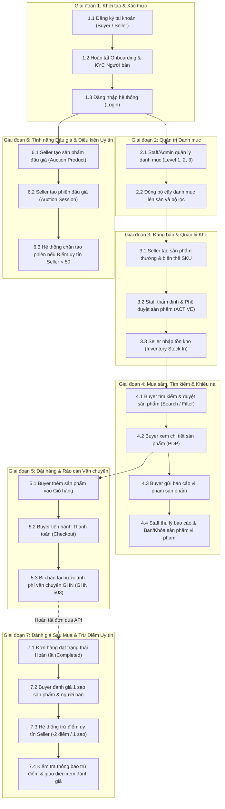

# TÀI LIỆU YÊU CẦU CẢI TIẾN & BÁO LỖI GIAO DIỆN (FE DEFECTS & IMPROVEMENTS SPECIFICATION)

> **Dự án:** Sàn Thương mại Điện tử & Đấu giá Nexus (Frontend: Next.js App Router / Turbopack)  
> **Người tổng hợp:** Backend & Lead QA Review  
> **Tài liệu tham chiếu Backend:** [`API_DOCUMENTATION.md`](API_DOCUMENTATION.md)  
> **Mốc thời gian kéo mã nguồn kiểm thử (Baseline Code Snapshot):** Tối ngày 26/11/2026 (~17:00, commit `6bf7644` tại `Nexus`)  
> **Ghi chú đối soát Git:** Toàn bộ quá trình kiểm thử, chụp ảnh màn hình bằng chứng và ghi nhận danh mục 19 lỗi trong tài liệu này được thực hiện trên bản build local kéo về từ **tối qua (26/11/2026)**. Các commit mới được merge lên remote `origin/dev` sáng nay (27/11/2026, ví dụ `8b25b7c`...) đang trong diện đối soát và nghiệm thu độc lập.  
> **Trạng thái:** Đang cập nhật liên tục (Rolling updates)  

---

## 🔄 KỊCH BẢN & LUỒNG KIỂM THỬ TOÀN TRÌNH (END-TO-END TEST WORKFLOW)

Tài liệu này chuẩn hóa toàn bộ hành trình kiểm thử nghiệp vụ thực tế (End-to-End User Journey) xuyên suốt 4 vai trò chính: **Người mua (Buyer)**, **Người bán (Seller)**, **Nhân viên duyệt (Staff)** và **Quản trị viên (Admin)**.

### 🗺️ Sơ đồ tổng thể luồng nghiệp vụ (E2E Flowchart)



---

### 📋 Ma trận 7 Chặng kiểm thử chi tiết (Step-by-Step Test Matrix)

| Chặng | Bước thực hiện | Vai trò thực hiện | Màn hình / Route | API Backend liên quan | Trạng thái & Vấn đề ghi nhận |
| :---: | :--- | :---: | :--- | :--- | :--- |
| **G1: Auth & KYC** | **1.1 Đăng ký tài khoản** | Khách vãng lai | `/register` (Bước 1) | `POST /api/v1/auth/register`, `POST /api/v1/auth/verify-otp` | ⚠️ Phát hiện **`FE-AUTH-01`** (Ô Email bị lệch lề, khác chiều cao). |
| | **1.2 Onboarding Seller & Địa chỉ** | Người bán | `/register` (Bước 2) | `GET /api/v1/fulfillment/shipping/provinces` (GHN) | ⛔ Phát hiện **`FE-ONBOARDING-02`** (Dropdown Tỉnh/Huyện/Xã bị liệt do GHN 503). |
| | **1.3 Tải hồ sơ KYC Người bán** | Người bán | `/account/seller-profile` | `POST /api/v1/users/me/seller-documents` | ⚠️ Phát hiện **`FE-UPLOAD-16`** (Dropzone nhận 10MB nhưng BE chặn 5MB). |
| | **1.4 Đăng nhập hệ thống** | Tất cả vai trò | `/login` | `POST /api/v1/auth/login` | ✅ Đăng nhập thành công, cấp phát JWT Bearer token và Role. |
| **G2: Category** | **2.1 Quản lý danh mục cây** | Staff / Admin | `/staff/categories` | `GET /api/v1/categories?tree=true`, `POST /api/v1/categories` | ✅ Hỗ trợ phân cấp `Level 1` (gốc), `Level 2/3` (con qua `ParentId`). |
| | **2.2 Điều hướng quản trị** | Staff / Admin | `/admin/*`, `/staff/*` | — | ⚠️ Phát hiện **`FE-NAV-06`** (Bị kẹt trong admin, bấm logo không về sàn). |
| **G3: Product & Stock** | **3.1 Tạo sản phẩm thường & SKU** | Người bán | `/seller/products/new` | `POST /api/v1/products`, `POST /api/v1/products/{id}/images` | ⚠️ Phát hiện **`FE-PRODUCT-03`** (Thiếu DxRxC SP), **`FE-VARIANT-04`** (Thiếu DxRxC SKU), **`FE-VARIANT-05`** (Placeholder cứng). |
| | **3.2 Thẩm định duyệt sản phẩm** | Staff | `/staff/products` | `PUT /api/v1/admin/products/{id}/status` | ✅ Chuyển trạng thái từ `PENDING_APPROVAL` sang `ACTIVE`. |
| | **3.3 Nhập kho sản phẩm** | Người bán | `/seller/inventory` | `POST /api/v1/inventory/stock-in` (Fulfillment) | ⚠️ Phát hiện **`FE-INVENTORY-07`** (Thiếu phiếu nhập/giá vốn), **`FE-INVENTORY-08`** (SP chưa duyệt vẫn tính tồn khả dụng). |
| **G4: Catalog & Report** | **4.1 Tìm kiếm & Duyệt sản phẩm** | Người mua | `/catalog`, Header Search | `GET /api/v1/products`, `GET /api/v1/products/search` | ⚠️ Phát hiện **`FE-CATALOG-17`** (Card thiếu sao), **`FE-SEARCH-18`** (Thiếu sort đánh giá/mới nhất, lệch Header/Sidebar). |
| | **4.2 Xem chi tiết sản phẩm (PDP)** | Người mua | `/catalog/[id]` | `GET /api/v1/products/{id}` | ✅ Hiển thị đầy đủ thông tin biến thể, ảnh, mô tả, tồn kho. |
| | **4.3 Gửi báo cáo sản phẩm vi phạm** | Người mua | `/catalog/[id]` | `POST /api/v1/reports/products` (CatalogService) | ⚠️ Phát hiện **`FE-CATALOG-09`** (Form báo cáo nhúng thô bạo trên PDP). |
| | **4.4 Xử lý báo cáo & Ban sản phẩm** | Staff | `/staff/product-reports` | `PUT /api/v1/admin/reports/products/{id}/action` | ⚠️ Phát hiện **`FE-STAFF-10`** (Quên đưa vào Sidebar), **`FE-STAFF-11`** (Bung form khổng lồ, báo cáo đã đóng vẫn cho submit). |
| **G5: Checkout & Logistics** | **5.1 Thêm vào giỏ hàng** | Người mua | `/cart` | Local state / Commerce Service | ✅ Thêm SKU vào giỏ hàng, cập nhật số lượng và tổng tiền. |
| | **5.2 Bấm tiến hành thanh toán** | Người mua | `/checkout` | `POST /api/v1/orders/prepare` | ✅ Chuyển sang màn hình xác nhận địa chỉ và chọn phương thức. |
| | **5.3 Tính phí vận chuyển GHN** | Hệ thống | `/checkout` | `POST /api/v1/fulfillment/shipping/fee` (GHN API) | ⛔ **Bị chặn:** API GHN Sandbox 503 không tính được phí ship làm đứt gãy luồng thanh toán (Cần dùng API nội bộ để hoàn tất). |
| **G6: Auctions & Reputation** | **6.1 Tạo sản phẩm đấu giá** | Người bán | `/seller/auctions/new/product` | `POST /api/v1/products/auction` (CatalogService) | ⚠️ Phát hiện **`FE-UPLOAD-16`** (Nhãn ghi tối đa 10MB nhưng submit báo 5MB). |
| | **6.2 Tạo phiên đấu giá mới** | Người bán | `/seller/auctions/new` | `POST /api/v1/auctions` (AuctionService) | ⚠️ Phát hiện **`FE-COMMON-13`** (Ô nhập tiền thiếu dấu phân cách hàng nghìn). |
| | **6.3 Kiểm tra điều kiện mở phiên** | Hệ thống | `/seller/auctions/new` | `POST /api/v1/auctions` (Chặn `sellerScore < 50`) | ⚠️ Phát hiện **`FE-AUCTION-14`** (Báo lỗi mơ hồ "không có quyền", nhầm điểm Buyer 85 với Seller 42). |
| | **6.4 Xem phiên theo dõi & Quản lý cọc** | Người mua | `/buyer/watchlist`, `/deposits`, `/auctions` | `GET /api/v1/me/watchlist`, `/me/deposits`, `/me/auctions` | ⛔ Phát hiện **`FE-AUCTION-19`** (Lỗi 404 "Không tìm thấy dữ liệu yêu cầu" do Gateway route nhầm sang UserService). |
| **G7: Review & Rating** | **7.1 Chuẩn bị đơn mua hoàn tất** | Hệ thống / API | `/buyer/orders` | `CommerceService` & `FulfillmentService` | ✅ Sử dụng đơn hàng hoàn tất sẵn: `ORD-0433A623` và `ORD-249EBC2C`. |
| | **7.2 Gửi đánh giá sản phẩm & shop** | Người mua | `/buyer/orders/{id}/review` | `POST /api/v1/reviews/products`, `POST /api/v1/users/{id}/reviews` | ✅ Gửi đánh giá 1 sao (kèm lý do và ảnh bằng chứng). |
| | **7.3 Trừ điểm uy tín Người bán** | Hệ thống | `UserService` / Reputation Engine | Tự động tính điểm: 1 sao = **-2 điểm**, 2 sao = **-1 điểm** | ✅ Điểm uy tín của Người bán bị trừ từ `42` xuống `40`. |
| | **7.4 Kiểm tra giao diện Người bán** | Người bán | `/seller/products`, `/seller/reviews`, Thông báo | `GET /api/v1/users/{id}/reviews`, `GET /api/v1/notifications` | ⚠️ Phát hiện **`FE-SELLER-15`** (Seller không có nơi xem đánh giá sản phẩm), **`FE-SELLER-12`** (Thông báo bị giấu kín). |

---

## 📑 DANH MỤC CÁC VẤN ĐỀ THEO PHÂN HỆ

| Mã Issue | Mức độ | Phân hệ / Màn hình | Tóm tắt vấn đề | Trạng thái |
| :---: | :---: | :--- | :--- | :---: |
| **FE-AUTH-01** | **Medium** | Đăng ký (`/register`) | Ô "Email nhận OTP" bị lệch lề, khác kích thước và kiểu dáng so với các ô còn lại | 🟡 Đã ghi nhận |
| **FE-ONBOARDING-02** | **Critical** | Đăng ký Seller (`/register` Bước 2) | Dropdown Tỉnh/Huyện/Xã bị liệt do API GHN 503, không có cơ chế Fallback làm tắc nghẽn luồng đăng ký | 🟡 Đã ghi nhận |
| **FE-PRODUCT-03** | **High** | Tạo sản phẩm (`/seller/products/new`) | Thiếu các trường kích thước 3 chiều (Dài x Rộng x Cao) cho đơn vị vận chuyển GHN | 🟡 Đã ghi nhận |
| **FE-VARIANT-04** | **High** | Biến thể SKU (`/seller/products/new`) | Thiếu các trường kích thước riêng (Dài x Rộng x Cao) theo từng biến thể SKU | 🟡 Đã ghi nhận |
| **FE-VARIANT-05** | **Low** | Biến thể SKU (`/seller/products/new`) | Placeholder ô Giá trị thuộc tính bị hardcode cứng "VD: Xanh Navy" bất kể loại thuộc tính | 🟡 Đã ghi nhận |
| **FE-NAV-06** | **Medium** | Điều hướng Admin/Staff (`/admin/*`) | Bị kẹt trong trang quản trị: Bấm Logo không về trang sàn và bị ẩn nút "Xem sàn thương mại" | 🟡 Đã ghi nhận |
| **FE-INVENTORY-07** | **High** | Quản lý kho (`/seller/inventory`) | Luồng nhập kho thô sơ: Chỉ gõ số lượng là vào thẳng tồn khả dụng, thiếu quy trình phiếu nhập & giá vốn | 🟡 Đã ghi nhận |
| **FE-INVENTORY-08** | **High** | Quản lý kho (`/seller/inventory`) | Cho phép nhập hàng và tính tồn "Khả dụng" cho sản phẩm chưa được duyệt (PendingApproval / Draft) | 🟡 Đã ghi nhận |
| **FE-CATALOG-09** | **Medium** | Chi tiết sản phẩm (`/catalog/[id]`) | Form "Báo cáo sản phẩm" nhúng lộ thiên nguyên khung to đùng ở thân trang, gây phản cảm UX | 🟡 Đã ghi nhận *(Remote dev có commit fix chờ kiểm chứng)* |
| **FE-STAFF-10** | **High** | Sidebar Staff/Admin (`/staff/*`) | Màn hình "Báo cáo sản phẩm" (`/staff/product-reports`) bị bỏ quên khỏi Sidebar (Orphan route) | 🟡 Đã ghi nhận *(Remote dev có commit fix chờ kiểm chứng)* |
| **FE-STAFF-11** | **Medium** | Báo cáo sản phẩm (`/staff/product-reports`) | Giao diện hiển thị bung xõa nguyên khối form cho từng đơn, chiếm diện tích khổng lồ | 🟡 Đã ghi nhận *(Remote dev có commit fix chờ kiểm chứng)* |
| **FE-SELLER-12** | **Medium** | Kênh người bán (`/seller/*`) | Nơi xem thông báo bị giấu sâu trong menu avatar góc trái, thiếu mục Thông báo trên Sidebar và Header | 🟡 Đã ghi nhận |
| **FE-COMMON-13** | **Medium** | Toàn sàn (Tạo SP, Đấu giá, Ví) | Các ô nhập tiền thiếu dấu phân tách hàng nghìn (, / .) khiến người dùng phải ngồi đếm số 0 | 🟡 Đã ghi nhận |
| **FE-AUCTION-14** | **Medium** | Tạo đấu giá (`/seller/auctions/new`) | Báo lỗi mơ hồ "không có quyền" thay vì báo thiếu điểm uy tín, giấu nhẹm điều kiện điểm tối thiểu >= 50 | 🟡 Đã ghi nhận |
| **FE-SELLER-15** | **High** | Kênh người bán (`/seller/products`, `/seller/reviews`) | Người bán hoàn toàn không có giao diện xem đánh giá và số sao của sản phẩm | 🟡 Đã ghi nhận |
| **FE-UPLOAD-16** | **High** | Tải ảnh (`FileDropZone`, Tạo SP đấu giá, Hồ sơ) | Lệch giới hạn dung lượng ảnh: FE để mặc định 10 MB và hiển thị nhãn 10 MB trong khi Backend chặn cứng 5 MB | 🟡 Đã ghi nhận |
| **FE-CATALOG-17** | **High** | Danh sách sản phẩm (`ProductCard` tại `/catalog`, `/`) | Thẻ sản phẩm hoàn toàn không hiển thị số sao đánh giá (`avgRating`) dù Backend đã trả sẵn trong DTO | 🟡 Đã ghi nhận |
| **FE-SEARCH-18** | **High** | Tìm kiếm & Bộ lọc (`/catalog`, Header Search) | Chưa khai thác hết API Search: Thiếu sắp xếp Đánh giá cao/Mới nhất, lệch đồng bộ từ khóa Header & Sidebar | 🟡 Đã ghi nhận |
| **FE-AUCTION-19** | **High** | Theo dõi phiên & Đấu giá của tôi (`/buyer/watchlist`, `/deposits`, `/auctions`) | Lỗi 404 "Không tìm thấy dữ liệu yêu cầu" do Gateway route nhầm `/api/v1/me/*` sang UserService (Đã bàn giao tại `CATALOG_HANDOFF_TO_GATEWAY.md`) | 🟡 Bàn giao Gateway |
| **FE-STAFF-20** | **High** | Kiểm duyệt đánh giá (`/staff/product-reviews`) | Lỗi 404 "Không tìm thấy dữ liệu yêu cầu" khi tải `GET /api/v1/admin/reviews` do Gateway route nhầm sang UserService (Đã bàn giao tại `CATALOG_HANDOFF_TO_GATEWAY.md`) | 🟡 Bàn giao Gateway |
| **FE-INV-21** | **Critical** | Quản lý kho (`/seller/inventory`) | Lỗ hổng cho phép nhập kho sản phẩm chưa được duyệt (`Draft`/`PendingApproval`) (Đã bàn giao tại `HANDOFF_TO_FE_AND_FULFILLMENT_INVENTORY_DEFECT.md`) | 🟡 Bàn giao FE & Fulfillment |

---

## 📌 CHI TIẾT TỪNG VẤN ĐỀ

---

### FE-AUTH-01: Ô "Email nhận OTP" bị lệch lề, khác kích thước và kiểu dáng so với các ô khác

#### 1. Thông tin chung
* **Màn hình (Route):** `http://localhost:3000/register` (Bước 1: Chọn vai trò & điền thông tin tài khoản)
* **File nguồn liên quan:**
  * Component form: `Nexus/src/features/auth/AuthScreens.tsx` (dòng 465 – 490)
  * Component Email: `Nexus/src/components/ui/EmailInput.tsx` & `EmailInput.css`
  * Global style form: `Nexus/src/styles/globals.css` (dòng 483 – 490)

#### 2. Hiện trạng thực tế (Current Behavior)
Trong hàng đầu tiên của form đăng ký (`.form-grid` gồm 2 cột: Cột trái là **Tên đăng nhập**, Cột phải là **Email nhận OTP**), ô Email bị lệch đáng kể so với toàn bộ các ô nhập liệu còn lại trên trang:

1. **Lệch chiều cao và kiểu dáng (Input Inconsistency):**
   * Các ô *"Tên đăng nhập"*, *"Họ"*, *"Tên"*, *"Số điện thoại"* dùng class chuẩn `.field`: Chiều cao `42px`, nền xám nhạt (`#f1f5f9`/`var(--surface)`), bo góc nhẹ.
   * Ô *"Email nhận OTP"* được bọc bởi component riêng `<EmailInput>` (`.u434`): Chiều cao cố định `48px`, nền trắng tinh (`#ffffff`), có viền xanh + hiệu ứng đổ bóng phát sáng (`box-shadow: 0 0 0 5px ...`) và icon tích xanh nằm bên trong.
2. **Lệch nhãn tiêu đề (Label Inconsistency):**
   * Nhãn *"Tên đăng nhập"* được render trực tiếp bên trong `<label className="field-wrap">`, kế thừa font size lớn (~15px) và màu chữ đen đậm.
   * Nhãn *"Email nhận OTP"* render qua class `.u434-lb` có `font-size: 13px`, màu xám (`#475569`), và có `margin-left: 2px; margin-bottom: 8px` khiến chữ bị thụt vào trong và khoảng cách với input không đều so với cột trái.
3. **Lệch trục dọc do dòng trạng thái xác thực (Vertical Shift):**
   * Component `<EmailInput>` có thêm dòng thông báo trạng thái bên dưới (`.u434-msg`: *"Email hợp lệ"* hoặc trợ giúp), chiếm thêm `~25px` chiều cao.
   * Cột trái không có dòng tương đương, dẫn đến việc hàng 1 bị bất đối xứng về chiều cao, làm xô lệch khoảng cách với hàng 2 (*"Họ & Tên"*).

#### 3. Hành vi kỳ vọng (Expected Behavior)
* **Đồng bộ kích thước:** Cả 2 ô *"Tên đăng nhập"* và *"Email nhận OTP"* phải có cùng chiều cao (khuyến nghị chuẩn hóa toàn bộ input form auth là `46px` hoặc `48px`), cùng `border-radius`, và màu nền nhất quán.
* **Đồng bộ nhãn (Label):** Nhãn *"Tên đăng nhập"* và *"Email nhận OTP"* phải có cùng `font-size: 13px`, `font-weight: 600`, màu chữ xám đậm `#475569`, và thẳng hàng ngang 100%.
* **Căn chỉnh lưới đối xứng:** Khi hiển thị dòng thông báo hợp lệ / lỗi dưới ô Email, cột bên cạnh vẫn giữ nguyên vị trí, không làm méo mó cấu trúc lưới 2 cột.

---

### FE-ONBOARDING-02: Dropdown Tỉnh/Thành, Quận/Huyện bị liệt do API GHN lỗi 503, thiếu cơ chế Fallback (Blocker luồng đăng ký Seller)

#### 1. Thông tin chung
* **Màn hình (Route):** `http://localhost:3000/register` (Bước 2: Hồ sơ gian hàng Seller)
* **Mức độ nghiêm trọng:** **CRITICAL (Blocker)** — Người dùng bị chặn hoàn toàn, không thể hoàn tất đăng ký Seller.
* **File nguồn liên quan:**
  * Component chọn địa chỉ: `Nexus/src/features/shipping/GhnLocationSelect.tsx` (dòng 33 – 120)
  * Service gọi API: `Nexus/src/features/shipping/location.service.ts`
  * Form đăng ký shop: `Nexus/src/features/seller/components/ShopRegistrationForm.tsx` (dòng 30 – 50)
  * API liên quan: `GET /api/v1/shipping/locations/provinces` (thuộc FulfillmentService :8006 qua Gateway :8080)

#### 2. Hiện trạng thực tế (Current Bug)
1. **API trả về HTTP 503:** Khi vào Bước 2, frontend tự động gọi API `GET /api/v1/shipping/locations/provinces`. Do môi trường local/dev chưa cấu hình Token GHN thật (`Carriers:GHN:Token` bị rỗng), `FulfillmentService` quăng lỗi:
   ```json
   {
     "status": 503,
     "errorCode": "LOCATION_SOURCE_UNAVAILABLE",
     "detail": "Shipping locations are temporarily unavailable."
   }
   ```
2. **Liệt toàn bộ dropdown:** Component `GhnLocationSelect.tsx` nhận lỗi 503 nên `provinces.data` bị rỗng $\to$ Cả 3 dropdown *"Tỉnh / Thành phố"*, *"Quận / Huyện"*, *"Phường / Xã"* không có bất kỳ option nào để chọn.
3. **Hiển thị thông báo nhưng vẫn chặn Submit:** Giao diện xuất hiện khung cảnh báo đỏ:
   > *"Danh sách tỉnh, quận, phường của GHN tạm thời không khả dụng. Địa chỉ của bạn vẫn được giữ nguyên. Bấm tải lại danh sách hoặc thử lại sau ít phút."*
   Tuy nhiên hàm validate `validateShopRegistrationFields` vẫn bắt buộc:
   * `provinceId` phải là số nguyên $> 0$
   * `districtId` phải là số nguyên $> 0$
   * `wardCode` không được rỗng
   $\implies$ Người dùng bấm nút **"Tiếp tục điền hồ sơ gian hàng"** thì form báo lỗi và đứng im tại chỗ. Không có cách nào đăng ký tài khoản Seller!

#### 3. Hành vi kỳ vọng (Expected Behavior)
* **Khả năng chịu lỗi & Graceful Degradation (Bắt buộc cho Production & Dev):**
  1. Khi dịch vụ GHN bị gián đoạn (hoặc môi trường Dev chưa có Token GHN), hệ thống **tuyệt đối không được làm chết đứng toàn bộ luồng đăng ký của người bán**.
  2. **Chế độ Dự phòng (Fallback Mode):** Cần có phương án dự phòng khi API vị trí không phản hồi (ví dụ: danh sách tĩnh offline các tỉnh thành lớn hoặc cho phép nhập địa chỉ tay tạm thời) để người dùng không bị kẹt ở bước đăng ký.

---

### FE-PRODUCT-03: Thiếu các trường kích thước 3 chiều (Dài x Rộng x Cao) cho đơn vị vận chuyển GHN

#### 1. Thông tin chung
* **Màn hình (Route):** `http://localhost:3000/seller/products/new` (Tạo sản phẩm) & `/seller/products/[id]/edit` (Chỉnh sửa sản phẩm)
* **Mức độ nghiêm trọng:** **HIGH** — Ảnh hưởng trực tiếp đến việc tính cước phí vận chuyển GHN và chốt đơn giao vận.
* **File nguồn liên quan:**
  * Component màn hình: `Nexus/src/features/seller/SellerScreens.tsx` (dòng 865 – 875)
  * Interface dữ liệu: `Nexus/src/features/seller/types.ts` (hoặc `CreateProductPayload`)
  * API liên quan: `POST /api/v1/products` & `PUT /api/v1/products/{id}` (CatalogService :8002)

#### 2. Hiện trạng thực tế (Current Bug)
1. **Thiếu trường nhập liệu trên giao diện:** Ở mục *1. Thông tin cơ bản & Ngành hàng*, form hiện tại chỉ có duy nhất ô nhập **"Khối lượng vận chuyển (gram) *"**, hoàn toàn không có các ô để nhập kích thước đóng gói: **Chiều dài**, **Chiều rộng**, **Chiều cao** (đơn vị: cm).
2. **Không đồng bộ với hợp đồng API Backend:** 
   * API Backend `CatalogService` (`POST /api/v1/products`) đã thiết kế sẵn các trường: `weightGrams`, `lengthCm`, `widthCm`, `heightCm`.
   * Giao diện Frontend hiện chỉ gửi `weightGrams`, bỏ qua hoàn toàn 3 kích thước `lengthCm`, `widthCm`, `heightCm`.
3. **Hệ quả vận hành:** Đơn vị vận chuyển Giao Hàng Nhanh (GHN) bắt buộc cần 3 kích thước Dài x Rộng x Cao để tính **khối lượng quy đổi thể tích** ($D \times R \times C / 5000$). Khi thiếu 3 thông số này, hệ thống chỉ tính cước theo cân nặng thực, dẫn đến việc tính sai cước phí giao hàng (đặc biệt với các mặt hàng cồng kềnh, nhẹ cân) hoặc bị đơn vị vận chuyển từ chối nhận hàng tại bưu cục.

#### 3. Hành vi kỳ vọng (Expected Behavior)
* **Bổ sung nhóm thông số kích thước đóng gói:**
  * Thêm 3 trường nhập liệu:
    * **Chiều dài (cm)** (`lengthCm`)
    * **Chiều rộng (cm)** (`widthCm`)
    * **Chiều cao (cm)** (`heightCm`)
  * Đặt chung nhóm với ô *"Khối lượng vận chuyển (gram)"* để người bán dễ dàng khai báo kích thước kiện hàng chuẩn quy cách đóng gói.
* **Gửi kèm vào Payload API:** Khi tạo hoặc chỉnh sửa sản phẩm, gửi đầy đủ các giá trị `lengthCm`, `widthCm`, `heightCm` lên API `CatalogService`.

---

### FE-VARIANT-04: Biến thể SKU thiếu các trường kích thước vận chuyển riêng (Dài x Rộng x Cao)

#### 1. Thông tin chung
* **Màn hình (Route):** `http://localhost:3000/seller/products/new` & `http://localhost:3000/seller/products/[id]/edit` (Mục *4. Biến thể SKU*)
* **Mức độ nghiêm trọng:** **HIGH** — Cần thiết cho các sản phẩm có các phiên bản kích thước/đóng gói khác nhau (size vali, màn hình, thùng hàng...).
* **File nguồn liên quan:**
  * Component màn hình: `Nexus/src/features/seller/SellerScreens.tsx` (dòng 1205 – 1215)
  * API liên quan: `POST /api/v1/products/{id}/variants`, `PUT /api/v1/variants/{id}` (CatalogService :8002)

#### 2. Hiện trạng thực tế (Current Bug)
1. **Chỉ có ô Khối lượng riêng:** Trong từng thẻ Biến thể SKU, form hiện chỉ cung cấp ô *"Khối lượng riêng (gram)"* kèm gợi ý *"Để trống dùng khối lượng sản phẩm gram"*.
2. **Thiếu kích thước 3 chiều riêng của biến thể:** Hoàn toàn không có các ô nhập: **Chiều dài riêng (cm)**, **Chiều rộng riêng (cm)**, **Chiều cao riêng (cm)** cho từng SKU.
3. **Không tận dụng API:** Thực tế Backend `CatalogService` trên bảng `ProductVariants` đã có sẵn các cột `LengthCm`, `WidthCm`, `HeightCm` cho từng biến thể, nhưng Frontend chưa mở trường nhập liệu.

#### 3. Hành vi kỳ vọng (Expected Behavior)
* Cung cấp các ô nhập kích thước riêng cho từng biến thể:
  * **Chiều dài (cm)**
  * **Chiều rộng (cm)**
  * **Chiều cao (cm)**
* Có placeholder gợi ý tương tự ô khối lượng: *"Để trống dùng chiều dài/rộng/cao chung của sản phẩm"*.
* Khi gửi request tạo / sửa biến thể, map đầy đủ `lengthCm`, `widthCm`, `heightCm` vào request DTO gửi lên Backend.

---

### FE-VARIANT-05: Placeholder ô Giá trị thuộc tính biến thể bị hardcode "VD: Xanh Navy" cho mọi loại thuộc tính

#### 1. Thông tin chung
* **Màn hình (Route):** `http://localhost:3000/seller/products/new` (Mục *4. Biến thể SKU* $\to$ *Thuộc tính phân loại của biến thể*)
* **Mức độ nghiêm trọng:** **LOW (UI/UX Inconsistency)**
* **File nguồn liên quan:**
  * Component màn hình: `Nexus/src/features/seller/SellerScreens.tsx` (dòng 1261 – 1265)

#### 2. Hiện trạng thực tế (Current Bug)
1. Trong phần định nghĩa thuộc tính biến thể, người dùng có thể bấm các nút preset có sẵn: `+ Màu sắc`, `+ Kích cỡ`, `+ Dung lượng`, `+ Chất liệu`, `+ Thuộc tính`.
2. Tuy nhiên, ô nhập **Giá trị** bên cạnh lại bị **hardcode tĩnh** text placeholder: `placeholder="Giá trị (VD: Xanh Navy)"` cho tất cả mọi hàng.
3. Khi người dùng chọn dòng **Kích cỡ**, **Dung lượng**, hay **Chất liệu**, ô giá trị vẫn hiển thị gợi ý là *"VD: Xanh Navy"*, gây khó hiểu và thiếu chuyên nghiệp về mặt trải nghiệm người dùng (UX).

#### 3. Hành vi kỳ vọng (Expected Behavior)
* Text placeholder của ô Giá trị cần tự động thay đổi theo ngữ cảnh tương ứng với Tên thuộc tính ở cột bên trái:
  * Nếu thuộc tính là **Màu sắc**: Gợi ý ví dụ như *"VD: Xanh Navy, Đen, Trắng Titanium..."*
  * Nếu thuộc tính là **Kích cỡ**: Gợi ý ví dụ như *"VD: S, M, L, XL, 40, 41, 42mm..."*
  * Nếu thuộc tính là **Dung lượng**: Gợi ý ví dụ như *"VD: 128GB, 256GB, 512GB, 1TB..."*
  * Nếu thuộc tính là **Chất liệu**: Gợi ý ví dụ như *"VD: Da bò, Thép không gỉ, Vải Cotton..."*
  * Nếu là thuộc tính tự do khác: Gợi ý chung *"Nhập giá trị thuộc tính..."*

---

### FE-NAV-06: Bị kẹt trong trang Quản trị — Bấm Logo không về lại Sàn mua sắm và bị ẩn nút "Xem sàn thương mại"

#### 1. Thông tin chung
* **Màn hình (Route):** `http://localhost:3000/admin/*` & `http://localhost:3000/staff/*` (Toàn bộ các trang Dashboard Quản trị và Vận hành)
* **Mức độ nghiêm trọng:** **MEDIUM (Navigation Trap / Khuyết thiếu điều hướng)**
* **File nguồn liên quan:**
  * Component khung Dashboard: `Nexus/src/components/layout/Shells.tsx` (dòng 250 – 279 & dòng 485 – 493)

#### 2. Hiện trạng thực tế (Current Bug)
1. **Logo Sidebar trỏ ngược lại chính trang quản trị:** Khi người dùng đang ở trong trang Quản trị (`/admin/overview`), Logo `NEXUS` ở góc trái trên cùng của thanh Sidebar được gắn link `href={portalHomeHref}` (tức là `/admin/overview`). Khi click vào Logo, trang chỉ tự reload lại màn hình quản trị chứ không đưa người dùng về trang chủ Sàn thương mại (`/`).
2. **Cố tình chặn hiển thị lối thoát ở menu người dùng:** Trong component `PortalAccountMenu` (menu tài khoản ở góc dưới Sidebar), code logic đang chặn tài khoản Admin và Staff:
   ```tsx
   const canAccessMarketplace = !isAdminOrStaff;
   if (canAccessMarketplace) {
     portalItems.push({ href: ROUTES.home, label: "Xem sàn thương mại" });
   }
   ```
   Do `canAccessMarketplace = false` đối với Admin và Staff, nút **"Xem sàn thương mại"** bị ẩn mất hoàn toàn.
3. **Hệ quả UX:** Người dùng sau khi bấm vào xem trang Quản trị hệ thống thì bị **"mắc kẹt" hoàn toàn bên trong trang Dashboard**. Không có bất kỳ nút, icon hay logo nào để quay trở về trải nghiệm sàn mua sắm thông thường (`/`), buộc phải tự tay gõ lại URL trên thanh địa chỉ của trình duyệt.

#### 3. Hành vi kỳ vọng (Expected Behavior)
* **Cung cấp lối thoát điều hướng linh hoạt cho Admin/Staff:**
  * Bổ sung mục điều hướng **"Xem sàn thương mại"** (hoặc *"Về trang mua sắm"*) dẫn về `ROUTES.home` (`/`) cho cả tài khoản Admin và Staff trong menu tài khoản Sidebar.
  * Hoặc cho phép Logo `NEXUS` dẫn về trang chủ sàn mua sắm (`/`) kèm đường dẫn quay lại trang quản trị rõ ràng.

---

### FE-INVENTORY-07: Luồng nhập kho thô sơ — Gõ số lượng là vào thẳng tồn khả dụng, thiếu quy trình phiếu nhập & giá vốn

#### 1. Thông tin chung
* **Màn hình (Route):** `http://localhost:3000/seller/inventory` (Quản lý kho $\to$ Tab *Sản phẩm & SKU trong kho*)
* **Mức độ nghiêm trọng:** **HIGH (Thiếu quy trình nghiệp vụ Quản lý Kho - Inbound WMS)**
* **File nguồn liên quan:**
  * Component màn hình: `Nexus/src/features/seller/SellerScreens.tsx` (dòng 1636 – 1672, modal `intakeModal`)
  * Service gọi API: `sellerCatalogService.adjustInventory` (FulfillmentService :8006)

#### 2. Hiện trạng thực tế (Current Bug)
1. **Nhập kho trực tiếp không qua quy trình:** Nút `+ Nhập hàng` hiện tại chỉ mở một popup đơn giản yêu cầu điền một con số thô (ví dụ: `10`) và một ô ghi chú ngắn. Khi người dùng bấm lưu, hệ thống lập tức cộng dồn thẳng 10 sản phẩm vào cột **Khả dụng** (`availableQuantity`) và mở bán ngay trên sàn.
2. **Thiếu phiếu nhập kho (Goods Receipt Note / Inbound Order):** Hoàn toàn không có khái niệm Phiếu nhập kho: Không có mã chứng từ (ví dụ: `PNK-20261127-001`), không có ngày lập phiếu, không có thông tin Nhà cung cấp / Nguồn hàng, không có người lập phiếu, không đính kèm được hóa đơn/chứng từ nguồn gốc.
3. **Thiếu ghi nhận giá vốn (Cost of Goods Sold - COGS):** Không có trường nhập giá nhập vốn đơn vị cho từng đợt hàng, khiến hệ thống không thể tính toán được giá trị tồn kho theo thời gian thực (FIFO/Bình quân gia quyền) cũng như không tính được lợi nhuận gộp thực tế của gian hàng.
4. **Không có các bước kiểm đếm trạng thái hàng về:** Không có quy trình phân chia trạng thái: *Tạo phiếu dự kiến $\to$ Hàng về kho $\to$ Kiểm đếm chất lượng (QA/QC) $\to$ Nhập kho sẵn sàng bán*. Bất kỳ số lượng nào gõ vào đều ngay lập tức trở thành hàng sẵn sàng bán ra thị trường.

#### 3. Hành vi kỳ vọng (Expected Behavior)
* **Nâng cấp thành quy trình quản lý phiếu nhập kho:**
  * Thay vì cộng dồn số lượng trực tiếp qua popup đơn giản, cần có quy trình lập **Phiếu nhập kho**:
    * Mã phiếu nhập, ngày tạo, nhà cung cấp / nguồn gốc hàng hóa.
    * Danh sách các SKU nhập trong phiếu, số lượng nhập từng SKU.
    * **Giá vốn nhập hàng (Đơn giá nhập)** để theo dõi chi phí và định giá tồn kho.
  * Hàng sau khi tạo phiếu cần trải qua bước xác nhận kiểm đếm thực tế trước khi chính thức chuyển vào số lượng "Khả dụng" trên sàn.
  * Lưu trữ lịch sử toàn bộ các phiếu nhập kho vào Tab **"Sổ kho"** để đối soát, tra cứu và kiểm toán khi cần.

---

### FE-INVENTORY-08: Cho phép nhập hàng và tính tồn "Khả dụng" cho sản phẩm chưa được duyệt (PendingApproval / Draft)

#### 1. Thông tin chung
* **Màn hình (Route):** `http://localhost:3000/seller/inventory` (Quản lý kho $\to$ Tab *Sản phẩm & SKU trong kho*)
* **Mức độ nghiêm trọng:** **HIGH (Xung đột quy tắc nghiệp vụ Trạng thái sản phẩm)**
* **File nguồn liên quan:**
  * Component màn hình: `Nexus/src/features/seller/SellerScreens.tsx` (dòng 1876 – 1883 & dòng 1636 – 1660)

#### 2. Hiện trạng thực tế (Current Bug)
1. **Cho phép nhập hàng sản phẩm chưa duyệt:** Tại bảng quản lý kho, sản phẩm *"Iphone Duo"* đang hiển thị nhãn `Trạng thái SP: PendingApproval` (Chờ duyệt). Tuy nhiên, nút **`+ Nhập hàng`** ở cột Thao tác vẫn được bật (Active) và cho phép người bán bấm vào nhập số lượng bình thường.
2. **Cộng thẳng vào tồn Khả dụng:** Sau khi nhập thành công, số lượng hàng được cộng dồn ngay vào cột **Khả dụng (Available)** (hiển thị số 20 màu xanh lá `#059669`).
3. **Mâu thuẫn logic nghiệp vụ:** Một sản phẩm đang chờ duyệt (hoặc ở trạng thái Bản nháp `Draft`, Bị từ chối `Rejected`) chưa hề được phép kinh doanh trên sàn, nhưng lại được ghi nhận tồn kho "Khả dụng" sẵn sàng giao dịch. Nếu sản phẩm sau đó bị từ chối phê duyệt, lượng hàng tồn khả dụng này sẽ trở thành rác dữ liệu trên hệ thống.

#### 3. Hành vi kỳ vọng (Expected Behavior)
* **Kiểm tra trạng thái sản phẩm trước khi thao tác kho:**
  * Với các sản phẩm chưa đạt trạng thái hoạt động chính thức (`Active` / Đang bán), cần **vô hiệu hóa nút `+ Nhập hàng`** (`disabled`) kèm tooltip giải thích: *"Sản phẩm cần được duyệt trước khi nhập kho thương mại"*.
  * Trong trường hợp hệ thống cho phép nhập hàng chuẩn bị trước (Pre-stocking): Số lượng hàng nhập này tuyệt đối **không được tính vào cột "Khả dụng"** mà phải nằm ở cột trạng thái riêng (ví dụ: *"Tồn chờ mở bán"* hoặc *"Tồn chưa duyệt"*), và chỉ tự động chuyển sang "Khả dụng" sau khi sản phẩm được Admin/Staff phê duyệt thành công.

---

### FE-CATALOG-09: Form "Báo cáo sản phẩm" nhúng lộ thiên nguyên khung khổng lồ ở thân trang, gây phản cảm trải nghiệm mua sắm (UX)

#### 1. Thông tin chung
* **Màn hình (Route):** `http://localhost:3000/catalog/[id]` (Trang chi tiết sản phẩm phía Người mua)
* **Mức độ nghiêm trọng:** **MEDIUM (UX Defect / Làm giảm tỷ lệ chuyển đổi mua hàng - CRO)**
* **File nguồn liên quan:**
  * Component phản hồi sản phẩm: `Nexus/src/features/catalog/ProductFeedback.tsx` (dòng 67 – 75)
  * Component chi tiết sản phẩm: `Nexus/src/features/catalog/ProductDetailScreen.tsx` (dòng 403)

#### 2. Hiện trạng thực tế (Current Bug)
1. **Nhúng thẳng form tố cáo vào luồng đọc chính:** Toàn bộ Form *"Báo cáo sản phẩm"* (gồm dropdown chọn lý do vi phạm, textarea mô tả dài và khu vực kéo thả upload ảnh bằng chứng) đang được render **nguyên một Card khổng lồ nằm lộ thiên ngay bên dưới phần đánh giá sản phẩm**.
2. **Ảnh hưởng tiêu cực đến tâm lý người mua hàng:** Khách hàng vào trang chi tiết sản phẩm với mục đích tìm hiểu tính năng, giá cả và đánh giá để quyết định mua sắm. Việc đập ngay vào mắt một form tố cáo to đùng (với các tùy chọn: *"Hàng giả", "Hàng cấm", "Mô tả sai"...*) tạo cảm giác bất an, nghi ngờ về chất lượng sản phẩm và uy tín của sàn.
3. **Lãng phí diện tích hiển thị:** Hơn 99% khách hàng bình thường không có nhu cầu tố cáo sản phẩm, nhưng vẫn bắt buộc phải cuộn qua một form chiếm dụng không gian rất lớn.

#### 3. Hành vi kỳ vọng (Expected Behavior)
* **Ẩn form tố cáo khỏi giao diện mặc định:** Tuyệt đối không nhúng form báo cáo dàn trải trực tiếp trên trang chi tiết sản phẩm.
* **Thay thế bằng nút tác vụ phụ tinh tế:**
  * Đặt một nút hoặc link nhỏ tinh tế (ví dụ: nút cờ `🚩 Báo cáo vi phạm` hoặc `Báo cáo sản phẩm này`) ở vị trí thứ cấp (ví dụ: cạnh nút Yêu thích/Chia sẻ ở đầu trang, hoặc đặt ở góc chân trang bên dưới phần thông tin Shop).
* **Hiển thị dưới dạng Modal / Popup:** Khi người dùng có nhu cầu tố cáo và click vào nút đó, hệ thống mới mở một **Modal Dialog (hoặc Popup)** chứa form điền lý do và upload ảnh bằng chứng. Sau khi gửi xong thì đóng Modal lại, trả lại trang sản phẩm gọn gàng, sạch sẽ.

---

### FE-STAFF-10: Màn hình "Báo cáo sản phẩm" bị bỏ quên khỏi Sidebar của Staff và Admin (Orphan Route)

#### 1. Thông tin chung
* **Màn hình (Route):** `http://localhost:3000/staff/product-reports` (hoặc `/admin/product-reports`)
* **Mức độ nghiêm trọng:** **HIGH (Missing Navigation / Tuyến trang mồ côi)**
* **File nguồn liên quan:**
  * Component điều hướng Sidebar: `Nexus/src/constants/navigation.ts` (mảng `staffNavigation` dòng 34 – 45 & `adminNavigation` dòng 47 – 73)
  * Component màn hình đã code sẵn: `Nexus/src/features/staff/StaffProductReportsScreen.tsx`

#### 2. Hiện trạng thực tế (Current Bug)
1. **Thiếu liên kết điều hướng trên Sidebar:** Trên thanh menu bên trái của Staff hiện chỉ có:
   * **"Duyệt sản phẩm"** (dẫn tới `/staff/product-moderation`: duyệt mở bán sản phẩm)
   * **"Khiếu nại & Vi phạm"** (dẫn tới `/staff/reports`: màn hình xử lý khiếu nại tài khoản của UserService)
2. Màn hình xử lý tố cáo vi phạm sản phẩm đã được xây dựng hoàn chỉnh tại `StaffProductReportsScreen.tsx` (route `/staff/product-reports`, gọi các API `GET /api/v1/admin/reports/products` và `PUT /api/v1/admin/reports/products/{id}/action` của `CatalogService`), nhưng **hoàn toàn bị bỏ quên, không được gắn vào bất kỳ vị trí nào trên Sidebar của Staff hay Admin**.
3. Nhân viên vận hành sau khi nhận thông báo có báo cáo sản phẩm không có cách nào bấm vào màn hình này từ menu, buộc phải tự gõ thủ công URL `http://localhost:3000/staff/product-reports` trên trình duyệt.

#### 3. Hành vi kỳ vọng (Expected Behavior)
* **Bổ sung mục điều hướng truy cập xử lý Báo cáo sản phẩm:**
  * Thêm mục **"Báo cáo sản phẩm"** (`/staff/product-reports`) trực tiếp lên Sidebar của Staff và Admin.
  * Hoặc trong mục *"Khiếu nại & Vi phạm"* (`/staff/reports`) hoặc *"Duyệt sản phẩm"* (`/staff/product-moderation`), tổ chức thành 2 Tab rõ ràng:
    * Tab 1: **Khiếu nại tài khoản & giao dịch**
    * Tab 2: **Báo cáo vi phạm sản phẩm** (trỏ tới `StaffProductReportsScreen`).

---

### FE-STAFF-11: Giao diện Báo cáo sản phẩm hiển thị bung xõa nguyên khối form cho từng đơn, chiếm diện tích khổng lồ

#### 1. Thông tin chung
* **Màn hình (Route):** `http://localhost:3000/staff/product-reports` & `http://localhost:3000/admin/product-reports`
* **Mức độ nghiêm trọng:** **MEDIUM (UI/UX Kém tối ưu cho trang Vận hành Staff)**
* **File nguồn liên quan:**
  * Component màn hình: `Nexus/src/features/staff/StaffProductReportsScreen.tsx` (dòng 35 – 45)

#### 2. Hiện trạng thực tế (Current Bug)
1. **Hiển thị dạng thẻ mở rộng toàn bộ (Full Expanded Cards):** Mỗi đơn báo cáo hiện tại đều render nguyên một khối card rất lớn chứa sẵn toàn bộ form xử lý (select box quyết định, textarea lý do lớn, nút lưu). Trang hiển thị 20 báo cáo sẽ tạo thành một danh sách dài hàng ngàn pixel, nhân viên phải cuộn chuột mỏi tay và hoàn toàn không thể có cái nhìn tổng quan hay so sánh nhanh giữa các đơn.
2. **Báo cáo đã xử lý vẫn hiện form nhập quyết định:** Các đơn báo cáo đã ở trạng thái kết thúc như `Resolved` (Đã xử lý) hoặc `Dismissed` (Đã bác) vẫn tiếp tục hiển thị form cho phép chọn quyết định và nhập lý do như một đơn mới chờ xử lý, gây hiểu nhầm về trạng thái dữ liệu.

#### 3. Hành vi kỳ vọng (Expected Behavior)
* **Chuyển đổi giao diện sang dạng Bảng tổng quan (Data Table) hoặc Master-Detail:**
  * Hiển thị danh sách báo cáo dạng bảng gọn gàng: Mã báo cáo, Tên sản phẩm, Lý do vi phạm, Thời gian gửi, Trạng thái (Badge màu) và Nút thao tác `Xử lý` (hoặc `Xem chi tiết`).
  * Chỉ mở form nhập quyết định (dropdown, lý do xử lý, ảnh bằng chứng) khi bấm nút `Xử lý` thông qua **Modal Dialog** hoặc **Drawer panel** trượt từ cạnh phải.
* **Phân biệt rõ ràng đơn Chờ xử lý vs Đã xử lý:** Đối với các đơn đã `Resolved` hoặc `Dismissed`, chỉ hiển thị thông tin kết quả xử lý (Read-only), không mở form nhập quyết định nữa.

---

### FE-SELLER-12: Chức năng Thông báo của Người bán bị giấu sâu trong menu avatar góc trái, thiếu điều hướng trực quan

#### 1. Thông tin chung
* **Màn hình (Route):** Toàn bộ Kênh người bán (`/seller/*`) & Trang thông báo (`http://localhost:3000/seller/notifications`)
* **Mức độ nghiêm trọng:** **MEDIUM (UX Defect / Gây khó khăn khi theo dõi biến động kinh doanh)**
* **File nguồn liên quan:**
  * Component khung Kênh người bán: `Nexus/src/components/layout/Shells.tsx` (`PortalShell` và `PortalAccountMenu`, dòng 280 – 290)
  * Cấu hình danh mục menu: `Nexus/src/constants/navigation.ts` (`sellerNavigation`, dòng 21 – 33)
  * Màn hình thông báo đã code: `Nexus/src/app/(dashboard)/seller/notifications/page.tsx` và `Nexus/src/features/notification/NotificationsScreen.tsx`

#### 2. Hiện trạng thực tế (Current Bug)
1. **Bị giấu sâu trong menu con của Avatar:** Trên toàn bộ giao diện Kênh người bán (`/seller/*`), người bán hoàn toàn không nhìn thấy bất kỳ biểu tượng Quả chuông nào ở thanh trên cùng (do Kênh người bán không có thanh Header chung như trang Buyer).
2. **Thiếu trên Sidebar chính:** Danh sách menu chức năng bên trái (`sellerNavigation`) có đầy đủ các mục (Quản lý sản phẩm, Quản lý kho, Đơn bán, Vận chuyển, Doanh thu & ví...) nhưng **hoàn toàn không có mục "Thông báo"**.
3. **Vị trí duy nhất hiện tại:** Người bán buộc phải bấm vào khối avatar tài khoản ở tận góc dưới cùng bên trái của màn hình (`PortalAccountMenu`), khi đó popup menu mới bật lên và xuất hiện dòng *"Thông báo"*. Vị trí này rất khuất, đi ngược lại thói quen tương tác của người dùng sàn TMĐT (vốn quen nhìn thấy quả chuông hoặc mục thông báo nổi bật).
4. **Hệ quả vận hành:** Người bán dễ bỏ lỡ các thông báo trọng yếu thời gian thực như: Sản phẩm được duyệt/bị từ chối, có đơn hàng mới cần đóng gói, người mua đánh giá sản phẩm, hoặc khiếu nại/cảnh báo vi phạm từ sàn.

#### 3. Hành vi kỳ vọng (Expected Behavior)
* **Đưa mục Thông báo ra vị trí dễ tiếp cận tức thì:**
  * **Cách tiếp cận 1 (Sidebar chính):** Thêm trực tiếp mục **"Thông báo"** (kèm icon chuông và Badge đỏ hiển thị số lượng chưa đọc realtime) vào danh sách menu bên trái (`sellerNavigation`), tương tự như Staff (`Trung tâm thông báo`) và Admin.
  * **Cách tiếp cận 2 (Thanh Header / Top bar):** Bổ sung một thanh Header tinh gọn cho Kênh người bán, tích hợp cụm icon Quả chuông (`NotificationBell`) có Badge đếm số thông báo mới và popup xem nhanh danh sách thông báo.

---

### FE-COMMON-13: Các ô nhập tiền tệ toàn sàn thiếu định dạng phân tách hàng nghìn, gây nguy cơ nhầm lẫn giá trị lớn

#### 1. Thông tin chung
* **Màn hình (Route):** Toàn bộ các form nhập liệu liên quan đến số tiền trên toàn hệ thống:
  * Tạo & Sửa phiên đấu giá (`/seller/auctions/new`, `/seller/auctions/[id]/edit`: Giá khởi điểm, Bước giá, Giá sàn, Giá mua ngay).
  * Tạo & Sửa sản phẩm (`/seller/products/new`, `/seller/products/[id]/edit`: Giá bán từng biến thể SKU).
  * Ví điện tử (`/buyer/wallet`, `/seller/wallet`, `/admin/wallet`: Số tiền nạp, rút, điều chỉnh).
  * Đặt giá thầu đấu giá (`/auctions/[id]`: Ô nhập giá đặt thầu).
* **Mức độ nghiêm trọng:** **MEDIUM (Global UX Defect / Nguy cơ cao gây lỗi giao dịch tài chính)**
* **File nguồn liên quan:**
  * Component tạo phiên đấu giá: `Nexus/src/features/auction/AuctionOperations.tsx` (dòng 567 – 580)
  * Component tạo sản phẩm: `Nexus/src/features/seller/SellerAuctionProductCreate.tsx` & `ProductCreateScreen.tsx`
  * Các component ví & nạp rút: `Nexus/src/features/wallet/`

#### 2. Hiện trạng thực tế (Current Bug)
1. **Hiển thị số thô không có dấu phân cách:** 100% các ô nhập số tiền hiện tại đều sử dụng input số thô (`<input type="number">`). Khi người dùng nhập các số tiền lớn (ví dụ: `3000000`, `3200000`, `40000000`), chuỗi số hiển thị liền một mạch không có dấu phân cách hàng nghìn (dấu phẩy `,` hoặc dấu chấm `.`).
2. **Buộc người dùng phải căng mắt đếm số 0:** Mỗi lần nhập hoặc kiểm tra lại giá, người dùng phải ngồi rà từng chữ số `0` để biết đây là 3 triệu, 30 triệu hay 300 triệu.
3. **Rủi ro sai lệch giá trị giao dịch rất cao:** Người bán rất dễ vô tình gõ thiếu hoặc thừa 1 số `0` (ví dụ: muốn đặt giá `30,000,000` nhưng gõ thành `3,000,000`), dẫn đến việc hàng hóa giá trị cao bị bán hớ hoặc phiên đấu giá bị định giá sai lệch nghiêm trọng.

#### 3. Hành vi kỳ vọng (Expected Behavior)
* **Tự động định dạng phân tách hàng nghìn khi nhập liệu (Currency Input Masking):**
  * Trong lúc người dùng gõ số, ô input cần tự động định dạng hiển thị dấu phân cách hàng nghìn (ví dụ: gõ `3000000` $\implies$ hiển thị trực quan `3,000,000` hoặc `3.000.000 ₫`).
  * Khi gửi dữ liệu (form submit / state), hệ thống vẫn chuyển đổi về dạng số nguyên thuần túy (raw number: `3000000`) để gửi lên API.
* **Hiển thị dòng chữ quy đổi giá trị trực quan bên dưới (Amount in Words / Helper Text):**
  * Ngay dưới ô nhập tiền, có dòng gợi ý đọc số tiền bằng chữ (ví dụ: *"3.000.000 ₫ — Ba triệu đồng"*, *"30.000.000 ₫ — Ba mươi triệu đồng"*), giúp người dùng nhìn lướt là xác nhận được ngay mệnh giá mà không cần phải đếm số `0`.

---

### FE-AUCTION-14: Báo lỗi mơ hồ "không có quyền" thay vì báo thiếu điểm uy tín, giấu nhẹm điều kiện điểm tối thiểu >= 50

#### 1. Thông tin chung
* **Màn hình (Route):** `http://localhost:3000/seller/auctions/new` (Tạo phiên đấu giá)
* **Mức độ nghiêm trọng:** **MEDIUM (UX Defect / Gây hiểu nhầm nghiêm trọng về quyền hạn và điều kiện nghiệp vụ)**
* **File nguồn liên quan:**
  * Component tạo phiên: `Nexus/src/features/auction/AuctionOperations.tsx` (dòng 564 – 568)
  * Service gọi API: `Nexus/src/features/auction/services/auction.service.ts`
  * API liên quan: `POST /api/v1/auctions` (AuctionService :8005) & `POST /api/v1/internal/users/check-reputation` (UserService :8001)

#### 2. Hiện trạng thực tế (Current Bug)
1. **Thông báo lỗi sai lệch bản chất:** Khi người bán nhấn *"Tạo phiên"*, `AuctionService` gọi `UserService` kiểm tra và bị từ chối với lý do thiếu điểm uy tín (`failureReason: "REPUTATION_TOO_LOW"` do điểm Seller hiện tại chỉ có 42 điểm, trong khi yêu cầu tối thiểu là 50). Tuy nhiên, giao diện Frontend chỉ quăng ra một dòng thông báo đỏ:
   > *"Bạn không có quyền thực hiện thao tác này."*
   Câu thông báo này khiến người dùng lầm tưởng tài khoản của mình bị mất quyền Seller, lỗi phân quyền (RBAC) hoặc hệ thống bị lỗi kỹ thuật, hoàn toàn không biết nguyên nhân cốt lõi là do thiếu điểm uy tín.
2. **Không công khai điều kiện và chỉ dẫn cụ thể:**
   * Giao diện không có cảnh báo hoặc hướng dẫn rõ ràng: *"Để mở phiên đấu giá, điểm uy tín Người bán cần đạt tối thiểu từ 50 trở lên. Hiện tại điểm của bạn là 42/50 (còn thiếu 8 điểm)"*.
   * Không có hướng dẫn cách thức giúp người bán cải thiện điểm uy tín (ví dụ: hoàn thành thêm đơn hàng, nhận đánh giá tốt).
3. **Hiển thị nhầm lẫn giữa Điểm Buyer và Điểm Seller:**
   * Hệ thống Nexus áp dụng cơ chế Điểm uy tín kép (Dual Reputation): Tài khoản có điểm Người mua (`buyerScore = 85` - Hạng Good) và điểm Người bán (`sellerScore = 42` - Hạng Probation).
   * Trên trang tạo phiên, Frontend lại lấy nhầm điểm Người mua (85) hiển thị, khiến người bán đinh ninh mình đã có 85 điểm (thừa điều kiện $\ge 50$) và bức xúc khi bị hệ thống chặn.
4. **Không chặn trước khi bấm (Thiếu Pre-submit Guard):**
   * Nếu người bán chưa đủ 50 điểm uy tín, hệ thống vẫn để họ tốn công chọn sản phẩm, biến thể SKU, điền 4 mức giá tiền và chọn thời gian bắt đầu/kết thúc, để rồi bấm Submit mới bị báo lỗi chặn lại.

#### 3. Hành vi kỳ vọng (Expected Behavior)
* **Thông báo lỗi chính xác, minh bạch theo ngữ cảnh nghiệp vụ:**
  * Khi Backend trả về lỗi do thiếu điểm uy tín (`REPUTATION_TOO_LOW`), thông báo phải ghi rõ:  
    👉 *"Điểm uy tín người bán của bạn hiện tại là 42/50, chưa đạt mức tối thiểu 50 điểm để tạo phiên đấu giá. Bạn cần thêm 8 điểm uy tín để mở tính năng này."*
* **Chặn ngay từ giao diện ban đầu (Pre-submit Guard & Guidance Banner):**
  * Hiển thị một Banner cảnh báo màu vàng/cam ngay đầu trang nếu `sellerScore < 50`:  
    > *"Tài khoản của bạn hiện có 42 điểm uy tín Seller (yêu cầu tối thiểu 50 điểm để tạo phiên đấu giá). Vui lòng hoàn thành thêm các đơn hàng thông thường để nâng cao điểm uy tín trước khi mở đấu giá."*
  * Đồng thời vô hiệu hóa nút *"Tạo phiên"* (`disabled`) để người dùng không mất thời gian điền form vô ích.
* **Đồng bộ đúng nguồn dữ liệu `sellerScore`:**
  * Toàn bộ Kênh người bán và trang Đấu giá phải đọc chính xác trường `sellerScore` từ `reputationService.getReputation()`, tuyệt đối không đọc nhầm trường `currentScore` / `buyerScore`.

---

### FE-SELLER-15: Kênh người bán hoàn toàn thiếu giao diện xem đánh giá và số sao của sản phẩm

#### 1. Thông tin chung
* **Màn hình (Route):**
  * Quản lý sản phẩm (`http://localhost:3000/seller/products`)
  * Đánh giá & uy tín (`http://localhost:3000/seller/reviews`)
  * Chi tiết sản phẩm phía Seller (`http://localhost:3000/seller/products/[id]`)
* **Mức độ nghiêm trọng:** **HIGH (Missing Core Business Feature / Thiếu tính năng trọng yếu cho Người bán)**
* **File nguồn liên quan:**
  * Bảng sản phẩm: `Nexus/src/features/seller/SellerScreens.tsx` (dòng 325 – 360)
  * Màn hình đánh giá: `Nexus/src/features/reviews/SellerReviewsScreen.tsx` (dòng 15 – 45)
  * Service gọi API: `Nexus/src/features/seller/services/seller-catalog.service.ts`
  * API Backend đã có sẵn: `CatalogService` `GET /api/v1/products` (đã trả sẵn `avgRating`), `GET /api/v1/products/{id}/rating-summary`, `GET /api/v1/products/{id}/reviews`.

#### 2. Hiện trạng thực tế (Current Bug)
1. **Bảng Quản lý sản phẩm thiếu hẳn cột Đánh giá / Số sao:**
   * Bảng sản phẩm hiện tại chỉ có 6 cột: *Sản phẩm*, *Danh mục*, *Giá bán*, *Biến thể SKU*, *Trạng thái*, *Thao tác*.
   * Mặc dù API `GET /api/v1/products` của `CatalogService` đã tính toán và trả về sẵn trường `avgRating` (ví dụ: `5.00` hoặc `null`), giao diện Frontend hoàn toàn không hiển thị cột đánh giá số sao. Người bán không thể biết sản phẩm nào đang được khách khen, sản phẩm nào bị khách chê.
2. **Trang "Đánh giá & uy tín" chỉ hiển thị đánh giá Shop (Người bán):**
   * Mục `/seller/reviews` trên Sidebar chỉ gọi API `GET /api/v1/users/{userId}/reviews` của `UserService` để hiển thị điểm uy tín và đánh giá Người bán (Partner review theo từng đơn hàng).
   * Trang này **hoàn toàn không có mục xem Đánh giá sản phẩm (Product Reviews)**.
3. **Người bán bị "mù thông tin" về chất lượng sản phẩm của chính mình:**
   * Khi người mua gửi đánh giá 1 sao hay 5 sao cho sản phẩm, Người bán hoàn toàn không có bất kỳ màn hình nào trên Kênh người bán (`/seller/*`) để xem danh sách nhận xét, phản hồi hoặc xem ảnh bằng chứng mà khách hàng chụp.
   * Cách duy nhất hiện tại để Người bán xem được đánh giá sản phẩm của mình là... phải tự đóng vai người mua ra trang chủ sàn thương mại (`/catalog/[id]`), gõ tìm kiếm sản phẩm của chính mình rồi kéo xuống cuối trang để xem như khách vãng lai!

#### 3. Hành vi kỳ vọng (Expected Behavior)
* **Bổ sung cột "Đánh giá" vào bảng Quản lý sản phẩm (`/seller/products`):**
  * Thêm cột hiển thị số sao trung bình kèm icon sao vàng và số lượt đánh giá (ví dụ: `⭐ 5.0 (1 đánh giá)` hoặc `⭐ Chưa có đánh giá`), giúp người bán nắm bắt nhanh chất lượng từng mặt hàng.
* **Bổ sung Tab hoặc Khu vực quản lý "Đánh giá sản phẩm" cho Shop:**
  * Tại trang **"Đánh giá & uy tín"** (`/seller/reviews`), phân chia làm 2 Tab rõ ràng:
    * **Tab 1: Đánh giá gian hàng & Điểm uy tín** (Hiển thị điểm `sellerScore` và review người bán như hiện tại).
    * **Tab 2: Đánh giá sản phẩm** (Hiển thị danh sách tất cả các đánh giá sản phẩm mà khách hàng đã gửi cho các mặt hàng của shop: Tên sản phẩm, Tên người mua, Số sao, Lời nhận xét, Ảnh đính kèm, Ngày gửi).
  * Cho phép người bán lọc theo từng sản phẩm và lọc theo số sao (1 sao đến 5 sao) để kịp thời cải thiện chất lượng dịch vụ hoặc phản hồi khiếu nại.

---

### FE-UPLOAD-16: Lệch giới hạn dung lượng ảnh giữa FE (10 MB) và Backend (5 MB)

#### 1. Thông tin chung
* **Màn hình / Component liên quan:**
  * Component tải tệp dùng chung: `Nexus/src/components/ui/FileDropZone.tsx` (dòng 59)
  * Màn hình Tạo sản phẩm đấu giá: `Nexus/src/features/seller/SellerAuctionProductCreate.tsx` (dòng 35 & 62)
  * Màn hình Tải giấy tờ đăng ký bán hàng: `Nexus/src/features/account/AccountScreens.tsx` (dòng 167 – 174)
* **Mức độ nghiêm trọng:** **HIGH (Data Validation Mismatch / Trải nghiệm tải tệp mâu thuẫn gây lỗi API)**
* **API Backend liên quan:**
  * `CatalogService`: `POST /api/v1/products/{id}/images` & `POST /api/v1/variants/{id}/images` (Chặn cứng $\le$ 5 MB, trả `VAL_LIMIT_EXCEEDED`)
  * `CatalogService`: `POST /api/v1/reports/products` (Chặn cứng $\le$ 5 MB, trả `VAL_LIMIT_EXCEEDED`)
  * `CatalogService`: `POST /api/v1/reviews/products` (Chặn cứng $\le$ 5 MB, trả `VAL_INVALID_INPUT`)

#### 2. Hiện trạng thực tế (Current Bug)
1. **Giá trị mặc định của component `FileDropZone` bị đặt sai thành 10 MB:**
   * Trong `FileDropZone.tsx`, tham số `maxSizeBytes` được gán giá trị mặc định là `10 * 1024 * 1024` (10 MB).
   * Trong khi đó, toàn bộ Backend Microservices của hệ thống chỉ cho phép tải tệp hình ảnh tối đa **5 MB** (`5 * 1024 * 1024` bytes).
2. **Mâu thuẫn ngay bên trong màn hình Tạo sản phẩm đấu giá (`/seller/auctions/new/product`):**
   * Tại dòng 62: Nhãn hướng dẫn hiển thị cho người bán là: `hint="JPG, PNG hoặc WEBP · tối đa 10 MB"` và không truyền `maxSizeBytes` (kế thừa mặc định 10 MB). Khi người dùng kéo thả ảnh 7 MB - 9 MB, `FileDropZone` vẫn nhận tệp và báo thành công tích xanh.
   * Tại dòng 35: Khi người dùng bấm nút *"Tạo và gửi duyệt"*, hàm kiểm tra client `submit()` lại kiểm tra `image.size > 5 * 1024 * 1024` và lập tức hiển thị thông báo lỗi màu đỏ: *"Điền tên, danh mục, khối lượng gram lớn hơn 0 và chọn ảnh JPG, PNG hoặc WEBP tối đa 5 MB."*
   * Người dùng bị bối rối hoàn toàn: Giao diện bên dưới vừa bảo "tối đa 10 MB", tệp tải lên đã báo hợp lệ, nhưng khi bấm gửi thì hệ thống lại từ chối và bảo "tối đa 5 MB".
3. **Lọt validation tại các màn hình không truyền `maxSizeBytes`:**
   * Tại màn hình Giấy tờ đăng ký người bán (`AccountScreens.tsx`), nhãn ghi `hint="JPG, PNG hoặc PDF · tối đa 5 MB"`, nhưng prop `maxSizeBytes` không được truyền vào `FileDropZone`.
   * Hệ thống cho phép người dùng chọn tệp từ 5 MB đến 10 MB mà không cảnh báo ngay tại component, chỉ phát sinh lỗi khi người dùng nhấn submit và API Backend từ chối nhận file với mã lỗi `400 Bad Request`.

#### 3. Hành vi kỳ vọng (Expected Behavior)
* **Đồng bộ toàn bộ giới hạn dung lượng tải ảnh về mức chuẩn 5 MB:**
  * Component `FileDropZone` phải có giá trị giới hạn mặc định `maxSizeBytes` là **5 MB** (`5 * 1024 * 1024` bytes) thay vì 10 MB để đồng nhất với năng lực xử lý và quy chuẩn lưu trữ của Backend.
  * Toàn bộ các dòng chữ hướng dẫn (`hint`), thông báo lỗi hiển thị và điều kiện kiểm tra ở form submit phải thống nhất hiển thị thông điệp: *"tối đa 5 MB"*.
* **Chặn lỗi tức thì ngay khi chọn tệp (Early File Drop Validation):**
  * Ngay khi người dùng thả hoặc chọn tệp có kích thước $> 5$ MB, component `FileDropZone` phải báo lỗi đỏ ngay lập tức (`Vượt quá 5 MB`) và không nhận tệp vào state của form, tránh tình trạng để người dùng điền hết toàn bộ thông tin rồi mới báo lỗi khi bấm submit.

---

### FE-CATALOG-17: Thẻ sản phẩm hoàn toàn không hiển thị số sao đánh giá dù Backend đã trả sẵn trong DTO

#### 1. Thông tin chung
* **Màn hình (Route):**
  * Trang khám phá sản phẩm: `http://localhost:3000/catalog`
  * Trang chủ sàn: `http://localhost:3000/`
  * Trang gian hàng người bán: `http://localhost:3000/seller/shop/[id]`
* **Mức độ nghiêm trọng:** **HIGH (Missing Social Proof & Trust Metric / Thiếu chỉ số tin cậy cốt lõi của sàn TMĐT)**
* **File nguồn liên quan:**
  * Component thẻ sản phẩm: `Nexus/src/features/catalog/CatalogScreens.tsx` (`ProductCard`, dòng 56 – 59)
  * Hook nạp sản phẩm: `Nexus/src/features/catalog/CatalogScreens.tsx` (`useProducts`, dòng 86 – 102)
  * DTO Backend đã trả sẵn: `CatalogService` `ProductListItemDto` có trường `decimal? AvgRating` (dòng 34 `ProductDtos.cs`).

#### 2. Hiện trạng thực tế (Current Bug)
1. **Thẻ sản phẩm (`ProductCard`) bỏ qua hoàn toàn trường dữ liệu `AvgRating`:**
   * DTO `ProductListItemDto` trả về từ API `GET /api/v1/products` và `GET /api/v1/products/search` của `CatalogService` luôn tính toán và cung cấp sẵn trường `AvgRating` (ví dụ: `5.00` hoặc `null` nếu chưa có đánh giá).
   * Tuy nhiên, component `ProductCard` trên Frontend chỉ render 5 thông tin: Ảnh sản phẩm, Tên thương hiệu/Danh mục, Tên sản phẩm, Nhãn trạng thái ("Đang bán"), và Giá tiền ("Giá bán 2.400.000 đ"). Hoàn toàn không hiển thị số sao đánh giá hay điểm trung bình.
2. **Gây mâu thuẫn trực tiếp với bộ lọc "Đánh giá tối thiểu":**
   * Ở thanh bên trái (`CatalogFilters`), hệ thống cung cấp bộ lọc *"Đánh giá tối thiểu: Từ 3 sao, Từ 4 sao, 5 sao"*.
   * Khi người dùng lọc sản phẩm theo số sao, kết quả các sản phẩm thỏa mãn điều kiện được hiển thị ra danh sách, nhưng trên mỗi thẻ sản phẩm lại không có bất kỳ ngôi sao hay con số nào để chứng minh sản phẩm đó đạt mấy sao, khiến người dùng cảm giác tính năng lọc đánh giá bị vô nghĩa hoặc dữ liệu không đồng nhất.

#### 3. Hành vi kỳ vọng (Expected Behavior)
* **Bổ sung cụm hiển thị số sao đánh giá trên mỗi thẻ sản phẩm (`ProductCard`):**
  * Hiển thị điểm đánh giá trung bình kèm icon sao (ví dụ: `⭐ 5.0` hoặc `⭐ Chưa có đánh giá`) nằm cạnh trạng thái sản phẩm hoặc ngay phía trên khối giá tiền.
  * Giúp người mua nhanh chóng nhận biết chất lượng và mức độ uy tín của sản phẩm ngay từ danh sách duyệt hàng mà không cần phải bấm vào từng trang chi tiết.

---

### FE-SEARCH-18: Bộ lọc & Tìm kiếm sản phẩm chưa khai thác hết năng lực API Search của Backend

#### 1. Thông tin chung
* **Màn hình (Route):** `http://localhost:3000/catalog` (Trang danh mục & tìm kiếm sản phẩm)
* **Mức độ nghiêm trọng:** **HIGH (Underutilized Search Capabilities & Search UX Disconnect)**
* **File nguồn liên quan:**
  * Bộ lọc trang catalog: `Nexus/src/features/catalog/CatalogScreens.tsx` (`CatalogFilters`, dòng 140 – 194)
  * Thanh tìm kiếm Header: `Nexus/src/components/layout/Shells.tsx` (`header-search`, dòng 410 – 424)
  * Hook gọi API: `Nexus/src/features/catalog/CatalogScreens.tsx` (`useProducts`, dòng 86 – 102)
  * Backend API hỗ trợ: `CatalogService` `GET /api/v1/products` & `GET /api/v1/products/search` (`ProductService.cs` dòng 140 – 170).

#### 2. Hiện trạng thực tế (Current Bug)
1. **Bỏ sót các tiêu chí sắp xếp cốt lõi của sàn TMĐT mà Backend đã hỗ trợ sẵn:**
   * Backend `CatalogService` đã lập trình sẵn cơ chế sắp xếp đa tiêu chí thông qua `sortBy` và `sortDirection`:
     * Sắp xếp theo Đánh giá cao nhất: `sortBy=rating&sortDirection=desc` (hoặc chuỗi gộp `rating_desc`).
     * Sắp xếp theo Sản phẩm mới nhất: `sortBy=createdat&sortDirection=desc` (hoặc `newest`/`newest_desc`).
     * Sắp xếp theo Tên bảng chữ cái: `sortBy=name&sortDirection=asc` (A-Z) hoặc `desc` (Z-A).
     * Sắp xếp theo Giá tiền: `sortBy=price&sortDirection=asc` / `desc`.
   * Tuy nhiên, trên giao diện Frontend (`CatalogScreens.tsx` dòng 193), dropdown "Sắp xếp giá" chỉ cung cấp vỏn vẹn đúng 2 lựa chọn cứng: *"Giá thấp đến cao"* (`price_asc`) và *"Giá cao đến thấp"* (`price_desc`).
   * Các tiêu chí trọng yếu như *"Đánh giá cao nhất"* và *"Mới nhất"* bị bỏ qua hoàn toàn. Đồng thời, logic ở dòng 202 lọc cứng `["price_asc", "price_desc"].includes(...)`, tự động xóa bỏ mọi tiêu chí sắp xếp khác nếu được truyền qua URL.
2. **Lệch đồng bộ giữa Thanh tìm kiếm Header và Bộ lọc Sidebar:**
   * Thanh tìm kiếm ở Header (`Shells.tsx`) là một form HTML độc lập, không có cơ chế đồng bộ dữ liệu hai chiều (two-way sync) với ô nhập "Tìm sản phẩm" ở sidebar bên trái (`CatalogFilters`).
   * Khi người dùng nhập từ khóa ở Header (ví dụ: *"iphone 16"* như trong ảnh), ô input tìm kiếm ở sidebar bên dưới vẫn để trống nguyên trạng (`Tên hoặc từ khóa`).
3. **Thiếu cơ chế gợi ý hoặc tìm kiếm linh hoạt (Search UX):**
   * Người dùng gõ từ khóa vào thanh tìm kiếm Header nhưng chưa có phản hồi tức thì hay gợi ý từ khóa (suggestion/debounce). Nếu người dùng chưa bấm nút submit, danh sách bên dưới vẫn hiển thị nguyên vẹn 35 sản phẩm mặc định mà không có chỉ dẫn rõ ràng.

#### 3. Hành vi kỳ vọng (Expected Behavior)
* **Khai thác đầy đủ các tiêu chí sắp xếp mà Backend hỗ trợ:**
  * Mở rộng dropdown sắp xếp trên giao diện với đầy đủ các tiêu chí:  
    * 🌟 **Đánh giá cao nhất** (`sortBy=rating`, `sortDirection=desc`)  
    * 🆕 **Mới nhất** (`sortBy=createdat`, `sortDirection=desc`)  
    * 💵 **Giá: Thấp đến Cao** (`sortBy=price`, `sortDirection=asc`)  
    * 💴 **Giá: Cao đến Thấp** (`sortBy=price`, `sortDirection=desc`)  
    * 🔤 **Tên: A đến Z** (`sortBy=name`, `sortDirection=asc`)  
  * Gửi đúng cặp tham số chuẩn `sortBy` và `sortDirection` lên API `GET /api/v1/products/search`.
* **Đồng bộ hai chiều từ khóa tìm kiếm giữa Header và Sidebar:**
  * Khi người dùng tìm kiếm từ Header, từ khóa phải tự động được điền và phản ánh chính xác vào ô "Tìm sản phẩm" ở bộ lọc sidebar khi chuyển đến trang `/catalog`.

---

### FE-AUCTION-19: Màn hình "Theo dõi phiên", "Cọc của tôi", "Đấu giá của tôi" bị lỗi 404 "Không tìm thấy dữ liệu yêu cầu"

#### 1. Thông tin chung
* **Màn hình (Route):**
  * Theo dõi phiên: `http://localhost:3000/buyer/watchlist`
  * Cọc của tôi: `http://localhost:3000/buyer/deposits`
  * Đấu giá của tôi: `http://localhost:3000/buyer/auctions`
* **Mức độ nghiêm trọng:** **HIGH (Broken Core Buyer Navigation / Toàn bộ các trang quản lý đấu giá cá nhân bị liệt)**
* **File nguồn liên quan:**
  * Màn hình Theo dõi phiên: `Nexus/src/features/auction/MyWatchlistScreen.tsx` (dòng 20, 33)
  * Service gọi API: `Nexus/src/features/auction/services/auction.service.ts` (dòng 75 – 76)
  * API Backend thực tế: `AuctionService` `[HttpGet("~/api/v1/me/watchlist")]` (`AuctionsController.cs` dòng 472).
  * Gateway định tuyến: `Gateway/appsettings.json` (thiếu cấu hình route ưu tiên cho `AuctionService`).

#### 2. Hiện trạng thực tế (Current Bug)
1. **Toàn bộ 3 mục đấu giá cá nhân trên thanh điều hướng đều báo lỗi 404:**
   * Khi người dùng nhấn vào bất kỳ mục nào trong 3 mục: **"Theo dõi phiên"**, **"Cọc của tôi"**, **"Đấu giá của tôi"**, giao diện lập tức hiện một thanh thông báo lỗi màu hồng/đỏ:  
     👉 *"Không tìm thấy dữ liệu yêu cầu."* kèm nút *"Thử lại"*.
   * Dù người dùng bấm nút *"Thử lại"* nhiều lần, lỗi 404 vẫn tiếp tục lặp lại và không thể tải danh sách.
2. **Nguyên nhân định tuyến tại ApiGateway:**
   * Frontend gửi request: `GET /api/v1/me/watchlist?page=1&pageSize=20`.
   * Tại ApiGateway (`Gateway:8080`), cấu hình có một route mặc định `user-me-route` bắt toàn bộ mẫu `/api/v1/me/{**catch-all}` và chuyển về `UserService` (`port 8001`).
   * Gateway đang thiếu cấu hình route ưu tiên (`Order: -1`) để chuyển hướng các tài nguyên đấu giá cá nhân (`/api/v1/me/watchlist`, `/api/v1/me/deposits`, `/api/v1/me/auctions`) về đúng `AuctionService` (`port 8005`).
   * Hậu quả: Request bị Gateway đẩy nhầm sang `UserService`. Vì `UserService` không có các endpoint này nên trả về mã lỗi `404 Not Found`.
3. **Trải nghiệm người dùng bị đứt gãy hoàn toàn:**
   * Thay vì hiển thị trạng thái danh sách rỗng thân thiện (ví dụ: *"Bạn chưa theo dõi phiên nào"* như code tại dòng 46 của `MyWatchlistScreen.tsx`), người dùng lại bị đập vào mắt thông báo lỗi hệ thống, gây cảm giác sàn bị lỗi tính năng.

#### 3. Hành vi kỳ vọng (Expected Behavior)
* **Khắc phục định tuyến Gateway cho các endpoint cá nhân của AuctionService:**
  * ApiGateway phải định tuyến chính xác các request `/api/v1/me/watchlist`, `/api/v1/me/deposits`, `/api/v1/me/auctions` về `AuctionService` (`port 8005`) thay vì chuyển sang `UserService`.
* **Hiển thị đúng trạng thái giao diện khi danh sách trống:**
  * Khi người dùng chưa theo dõi phiên nào, giao diện phải hiển thị thông điệp Empty State chuẩn: *"Bạn chưa theo dõi phiên nào. Hãy khám phá các phiên đấu giá trực tuyến và bấm Theo dõi để nhận thông báo giá mới."* thay vì báo lỗi "Không tìm thấy dữ liệu yêu cầu".

---

### FE-STAFF-20: Màn hình "Kiểm duyệt đánh giá sản phẩm" bị lỗi 404 "Không tìm thấy dữ liệu yêu cầu"

#### 1. Thông tin chung
* **Màn hình (Route):** `http://localhost:3000/staff/product-reviews`
* **Mức độ nghiêm trọng:** **HIGH (Broken Staff Moderation)**
* **File nguồn liên quan:**
  * Component màn hình: `Nexus/src/app/(dashboard)/staff/product-reviews/page.tsx`
  * Gateway định tuyến: `Gateway/Gateway/appsettings.json`
  * Controller Backend: `Catalog.Api.Controllers.Public.AdminReviewsController` (`GET /api/v1/admin/reviews`)
  * Controller bị trỏ nhầm: `User.Api.Controllers.AdminReviewsController` (`PUT /api/v1/admin/reviews/{id}/hide`)

#### 2. Hiện trạng thực tế (Current Bug)
1. **Lỗi 404 hiển thị ngay khi vào trang kiểm duyệt:**
   * Khi nhân viên Staff truy cập vào màn hình "Kiểm duyệt đánh giá", bảng danh sách không tải được dữ liệu và hiện thông báo lỗi màu hồng: *"Không tìm thấy dữ liệu yêu cầu."*
   * Tab Network của trình duyệt ghi nhận request: `GET http://localhost:3000/api/gateway/api/v1/admin/reviews?page=1&pageSize=20` trả về mã trạng thái `404 Not Found`.
2. **Nguyên nhân xung đột tại ApiGateway:**
   * Tại `Gateway/Gateway/appsettings.json`, route `admin-reviews-route` khớp toàn bộ mẫu `/api/v1/admin/reviews/{**catch-all}` và chuyển hướng sang `user-cluster` (`UserService:8001`).
   * `UserService` là dịch vụ quản lý người dùng, chỉ có endpoint `PUT /api/v1/admin/reviews/{reviewId}/hide` để ẩn đánh giá đối tác (Peer Reviews), hoàn toàn không sở hữu endpoint `GET /api/v1/admin/reviews`.
   * Endpoint `GET /api/v1/admin/reviews` thực tế nằm ở `CatalogService:8002` (`AdminReviewsController.cs`) để phục vụ kiểm duyệt đánh giá sản phẩm.
   * Do đó, request bị Gateway đẩy nhầm sang `UserService` dẫn đến lỗi `404 Not Found`.

#### 3. Hành vi kỳ vọng (Expected Behavior)
* **Định tuyến chính xác API lấy danh sách đánh giá:**
  * Request `GET /api/v1/admin/reviews` phải được ApiGateway chuyển tiếp chính xác đến `CatalogService` (port `8002`).
  * Màn hình `/staff/product-reviews` phải hiển thị danh sách các bài đánh giá sản phẩm cần kiểm duyệt hoặc hiển thị trạng thái *"Không có đánh giá nào khớp bộ lọc"* nếu danh sách trống.

---

### FE-INV-21 / BE-FULFILL-01: Lỗ hổng cho phép nhập kho cho sản phẩm chưa được Staff phê duyệt (Draft / PendingApproval)

#### 1. Thông tin chung
* **Màn hình (Route):** `http://localhost:3000/seller/inventory`
* **Mức độ nghiêm trọng:** **CRITICAL (Lỗ hổng logic nghiệp vụ kho & kiểm duyệt sàn)**
* **File nguồn liên quan:**
  * Component màn hình: `Nexus/src/features/seller/SellerScreens.tsx` (dòng 1509 & 1895–1928)
  * Service Frontend: `Nexus/src/features/seller/services/catalog.service.ts`
  * Backend xử lý kho: `FulfillmentService/Fulfillment.Application/Services/Inventory/InventoryAppService.Items.cs` (`ApplyAdjustment`)
  * Tài liệu bàn giao kỹ thuật: [docs/HANDOFF_TO_FE_AND_FULFILLMENT_INVENTORY_DEFECT.md](HANDOFF_TO_FE_AND_FULFILLMENT_INVENTORY_DEFECT.md)

#### 2. Hiện trạng thực tế (Current Bug)
1. **Frontend không chặn nút "+ Nhập hàng":**
   * Màn hình `/seller/inventory` liệt kê toàn bộ sản phẩm của shop từ `GET /api/v1/seller/products`, bao gồm cả sản phẩm đang `Draft` và `PendingApproval`.
   * Nút bấm `+ Nhập hàng` (dòng 1924) chỉ kiểm tra `disabled={!isOwnWarehouse || batchBalances.loading}`, hoàn toàn không kiểm tra `product.status === "ACTIVE"`. Do đó nút luôn sáng và Seller có thể bấm mở modal nhập hàng.
2. **Backend FulfillmentService tự ý tạo mới Item trong kho:**
   * Khi FE gửi request `POST /api/v1/inventories/adjust` với `type = "Intake"`, phương thức `ApplyAdjustment` của `FulfillmentService` kiểm tra nếu `existingItem == null` thì **tự động gọi `InventoryItem.Create(skuId, warehouse.Id, 0)`** mà không hề kiểm tra lại với `CatalogService` xem sản phẩm đã được duyệt hay chưa.
   * Kết quả: Hàng hóa chưa được kiểm duyệt vẫn được nhập vào kho và tăng số lượng tồn khả dụng thành công.

#### 3. Hành vi kỳ vọng (Expected Behavior)
1. **Frontend:** Nút `+ Nhập hàng` bắt buộc phải bị `disabled` nếu `product.status.toUpperCase() !== "ACTIVE"`. Thêm nhãn cảnh báo *"Chưa thể nhập hàng (Chờ duyệt)"* trên bảng kho.
2. **Backend FulfillmentService:** Bỏ hành vi tự động tạo mới `InventoryItem` khi nhận lệnh Intake nếu SKU chưa từng được khởi tạo từ `CatalogService` (`POST api/v1/internal/inventories/initialize`), hoặc phải gọi S2S xác minh với `CatalogService` qua `POST /api/v1/internal/variants/check-status` trước khi chấp nhận nhập kho.


