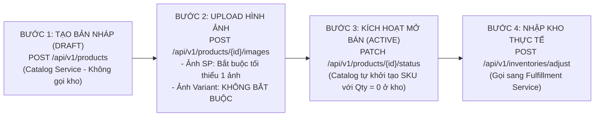

# TÀI LIỆU HƯỚNG DẪN TÍCH HỢP FRONTEND: LUỒNG TẠO SẢN PHẨM & NHẬP KHO CHUẨN E-COMMERCE

> **Dành cho:** Đội ngũ Frontend Developers (Seller Center Web, Buyer App, Admin Portal)  
> **Dịch vụ tích hợp:**  
> - **Catalog Service:** Port `8002` (Quản lý Danh mục, Sản phẩm, Biến thể, Ảnh, Thông số kỹ thuật)  
> - **Fulfillment Service:** Port `8006` (Quản lý Tồn kho vật lý, Phiếu nhập/điều chỉnh kho)  
> **Cập nhật lần cuối:** 2026-11-06  

---

## 1. Lưu Ý Bắt Buộc Đối Với Frontend (Quan Trọng)

> [!IMPORTANT]
> **FRONTEND CẦN BỎ HOÀN TOÀN CÁC RÀNG BUỘC TỒN KHO SAU ĐÂY:**
> 1. **BỎ điều kiện bắt buộc nhập số lượng tồn kho khi tạo sản phẩm / biến thể:** Form tạo sản phẩm ở trạng thái bản nháp (`DRAFT`) **không yêu cầu** nhập số lượng hàng trong kho.
> 2. **BỎ điều kiện tồn kho > 0 khi bấm kích hoạt ("Đăng bán" / Active):** Không chặn nút chuyển trạng thái sang `ACTIVE` nếu tồn kho bằng 0. Khi sản phẩm chuyển sang `ACTIVE`, hệ thống sẽ tự động khai báo mã SKU sang kho với **số lượng mặc định bằng `0`** (`totalQuantity = 0, availableQuantity = 0`).
> 3. **Số lượng hàng thực tế được nhập qua phiếu nhập kho riêng:** Sau khi sản phẩm đã được kích hoạt trên sàn, Seller sẽ vào tính năng quản lý kho hàng để gọi API nhập kho sang **Fulfillment Service** nhằm cập nhật số lượng thực tế.

---

## 2. Quy Trình 4 Bước Tích Hợp API



---

### BƯỚC 1: Tạo Sản phẩm & Biến thể ở trạng thái Bản Nháp (`DRAFT`)

* **Endpoint:** `POST /api/v1/products` (Catalog Service)
* **Headers:**
  * `Authorization: Bearer <seller_token>`
  * *(Hoặc khi test dev: `X-User-Id: <seller_uuid>`, `X-User-Roles: seller`)*
* **Mô tả:** Khai báo thông tin mô tả, danh mục, thông số kỹ thuật (dạng danh sách cặp `{ name, value }`) và các biến thể ban đầu.
* **Lưu ý:** Sản phẩm tạo mới luôn ở trạng thái `Draft` và **hoàn toàn không gọi sang kho Fulfillment**.

#### Request Body Mẫu (`POST /api/v1/products`):
```json
{
  "categoryId": "10000000-0000-0000-0000-000000000001",
  "name": "Bàn Phím Cơ Không Dây Nexus RGB V2",
  "brand": "Nexus Tech",
  "description": "Bàn phím cơ Bluetooth 5.1 hotswap 3 modes kết nối.",
  "saleType": "Regular",
  "specifications": [
    { "name": "Switch Type", "value": "Gateron Yellow Pro" },
    { "name": "Kết nối", "value": "Bluetooth 5.1 / 2.4Ghz / Type-C" },
    { "name": "Dung lượng pin", "value": "4000mAh" }
  ],
  "variants": [
    {
      "skuCode": "KB-NEXUS-01-WHITE",
      "name": "Màu Trắng - Gateron Yellow",
      "price": 1250000,
      "currency": "VND",
      "attributes": [
        { "attrName": "Màu sắc", "attrValue": "Trắng" },
        { "attrName": "Switch", "attrValue": "Yellow" }
      ]
    },
    {
      "skuCode": "KB-NEXUS-01-BLACK",
      "name": "Màu Đen - Gateron Red",
      "price": 1290000,
      "currency": "VND",
      "attributes": [
        { "attrName": "Màu sắc", "attrValue": "Đen" },
        { "attrName": "Switch", "attrValue": "Red" }
      ]
    }
  ]
}
```

#### Response Body Mẫu (`201 Created`):
```json
{
  "id": "294b5b66-9700-4697-a471-301706b838c6",
  "sellerId": "cccccccc-3333-3333-3333-333333333333",
  "categoryId": "10000000-0000-0000-0000-000000000001",
  "name": "Bàn Phím Cơ Không Dây Nexus RGB V2",
  "status": "Draft"
}
```

> **Lưu ý:**
> - Lưu lại `id` của sản phẩm (`productId`) từ response.
> - Trường `specifications` nhận mảng các object `{ "name": "...", "value": "..." }` (tối đa 30 mục), không còn dùng chuỗi JSON thô.
> - Nếu muốn thêm biến thể sau khi đã tạo sản phẩm, gọi API: `POST /api/v1/products/{id}/variants`.

---

### BƯỚC 2: Tải Lên Hình Ảnh Sản Phẩm & Biến Thể

* **Endpoint:** `POST /api/v1/products/{productId}/images` (Catalog Service)
* **Content-Type:** `multipart/form-data`
* **Phân biệt 2 loại ảnh:**
  1. **Ảnh đại diện sản phẩm (Product Images):**
     * **BẮT BUỘC:** Sản phẩm **phải có ít nhất 1 ảnh active (`isActive = true`)** thì mới đủ điều kiện kích hoạt sang `ACTIVE`.
     * Request: `file`, `isActive = true`, `sortOrder = 0`, `altText = "Ảnh chính sản phẩm"`.
  2. **Ảnh riêng của từng biến thể (Variant Images):**
     * **KHÔNG BẮT BUỘC (Optional):** Tùy chọn dành cho các biến thể có màu sắc hoặc phiên bản riêng biệt.
     * Request: bổ sung thêm tham số `variantId = "<variant_uuid>"`.

---

### BƯỚC 3: Kích Hoạt Mở Bán Sản Phẩm (`DRAFT` $\to$ `ACTIVE`)

* **Endpoint:** `PATCH /api/v1/products/{productId}/status` (Catalog Service)
* **Mục đích:** Đưa sản phẩm lên sàn mở bán.
* **Xử lý tự động tại Backend (2 chặng liên service):**
  1. *Chặng 1 (Xác định kho của Seller):* Backend Catalog gọi `GET /api/v1/warehouses/seller/{sellerId}` sang Fulfillment Service để tìm đúng ID kho đang active của Seller (`targetWarehouseId`). Nếu Seller chưa từng tạo kho riêng, hệ thống tự động fallback lấy kho trung tâm của sàn qua `GET /api/v1/warehouses`.
  2. *Chặng 2 (Tạo SKU tại đúng kho đó):* Gọi `POST /api/v1/inventories/initialize` để khai báo SKU đúng vào `targetWarehouseId` với số lượng ban đầu là **`0`** (`initialQuantity: 0`).
  * Chạy trong Database Transaction: nếu Fulfillment Service lỗi hoặc không khả dụng, hệ thống sẽ tự động rollback trạng thái về `Draft` và trả về `502 Bad Gateway`.
* **Lưu ý Frontend:** **Không kiểm tra tồn kho trước khi gửi request này**.

#### Request Body Mẫu (`PATCH /api/v1/products/{productId}/status`):
```json
{
  "status": "Active",
  "statusReason": "Khai báo hoàn tất và sẵn sàng kinh doanh."
}
```

#### Các mã lỗi Frontend cần xử lý:
| HTTP Status | Error Code | Lý do & Cách thông báo trên UI |
| :---: | :--- | :--- |
| `400 Bad Request` | `VAL_NO_ACTIVE_IMAGES` | **Chưa có ảnh đại diện:** *"Vui lòng tải lên ít nhất 1 hình ảnh sản phẩm trước khi đăng bán."* |
| `400 Bad Request` | `VAL_NO_ACTIVE_VARIANTS` | **Chưa có biến thể:** *"Vui lòng tạo ít nhất 1 biến thể hàng hóa trước khi đăng bán."* |
| `502 Bad Gateway` | `FULFILLMENT_UNAVAILABLE` | **Lỗi dịch vụ kho:** *"Dịch vụ kho hàng tạm thời không khả dụng. Vui lòng thử lại sau giây lát."* |

---

### BƯỚC 4: Nhập Kho Hàng Thực Tế (Fulfillment Service API)

Sau khi sản phẩm đã chuyển sang `ACTIVE`, toàn bộ biến thể đã tồn tại trong hệ thống kho với số lượng là `0` (trên trang Buyer hiển thị trạng thái *"Tạm hết hàng"*).

Để cập nhật số lượng hàng thực tế, Frontend gọi trực tiếp API điều chỉnh / nhập kho của **Fulfillment Service**:

* **Endpoint:** `POST /api/v1/inventories/adjust` (Fulfillment Service - Port `8006`)
* **Headers:**
  * `Authorization: Bearer <seller_token>`
  * *(Hoặc khi dev: `X-User-Id: <seller_uuid>`, `X-User-Roles: seller`)*
* **Mục đích:** Ghi nhận số lượng hàng thực tế nhập vào kho theo từng mã SKU/Biến thể (`skuId` / `variantId`).

#### Request Body Mẫu (`POST /api/v1/inventories/adjust`):
```json
{
  "skuId": "2ee975ad-876a-456a-8a3f-c06cdc716ff9",
  "sellerId": "cccccccc-3333-3333-3333-333333333333",
  "quantity": 100,
  "reason": "Nhập kho lô hàng đầu tiên từ nhà máy",
  "referenceCode": "PO-20261106-001"
}
```

#### Tra Cứu Tồn Kho Sau Khi Nhập:
* **Endpoint:** `GET /api/v1/inventories/{variantId}` (Fulfillment Service)
* **Response Body Mẫu (`200 OK`):**
```json
{
  "skuId": "2ee975ad-876a-456a-8a3f-c06cdc716ff9",
  "sellerId": "cccccccc-3333-3333-3333-333333333333",
  "totalQuantity": 100,
  "availableQuantity": 100,
  "reservedQuantity": 0
}
```
* **Hiển thị Buyer:** Khi `availableQuantity > 0`, sản phẩm sẽ tự động hiển thị nút **"Mua ngay" / "Thêm vào giỏ hàng"**.

---

## 3. Bảng Tổng Hợp Endpoint & Dịch Vụ Phụ Trách

| Hành động của Seller | Dịch vụ phụ trách | Method | Endpoint | Bắt buộc / Tùy chọn |
| :--- | :--- | :---: | :--- | :---: |
| 1. Tạo sản phẩm bản nháp | **Catalog Service** | `POST` | `/api/v1/products` | Bắt buộc |
| 2. Thêm biến thể lẻ (nếu có) | **Catalog Service** | `POST` | `/api/v1/products/{id}/variants` | Tùy chọn |
| 3. Tải ảnh đại diện sản phẩm | **Catalog Service** | `POST` | `/api/v1/products/{id}/images` | **Bắt buộc** (Ít nhất 1 ảnh) |
| 4. Tải ảnh cho từng biến thể | **Catalog Service** | `POST` | `/api/v1/products/{id}/images` *(kèm variantId)* | **Không bắt buộc** (Tùy chọn) |
| 5. Đăng bán sản phẩm (`Active`) | **Catalog Service** | `PATCH` | `/api/v1/products/{id}/status` | Bắt buộc *(Tự động gán kho Qty = 0)* |
| 6. Nhập hàng thực tế vào kho | **Fulfillment Service**| `POST` | `/api/v1/inventories/adjust` | Bắt buộc để có hàng bán |
| 7. Tra cứu tồn kho biến thể | **Fulfillment Service**| `GET` | `/api/v1/inventories/{variantId}` | Phục vụ hiển thị tồn kho |
