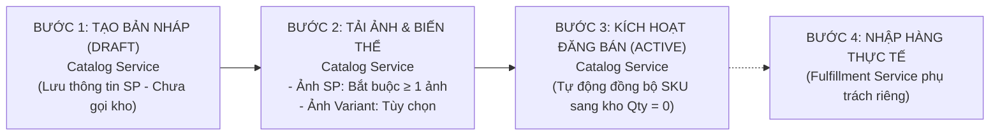

# TÀI LIỆU HƯỚNG DẪN TÍCH HỢP FRONTEND: LUỒNG TẠO SẢN PHẨM & MỞ BÁN (CATALOG SERVICE)

> **Dành cho:** Đội ngũ Frontend Developers (Seller Center Web, Buyer App, Admin Portal)  
> **Dịch vụ phụ trách:** **Catalog Service** (Port `8002` - Quản lý Danh mục, Sản phẩm, Biến thể, Ảnh, Thông số kỹ thuật)  
> **Cập nhật lần cuối:** 2026-11-06  

---

## 1. Phạm Vi Trách Nhiệm Của Catalog Service

* **Catalog Service đảm nhiệm:**
  1. Quản lý toàn bộ thông tin sản phẩm, danh mục, thông số kỹ thuật, hình ảnh và biến thể (SKU).
  2. Quản lý vòng đời hiển thị của sản phẩm (`Draft` $\rightarrow$ `Active` $\rightarrow$ `Inactive`).
  3. Khi sản phẩm được kích hoạt (`Active`), Catalog Service tự động thông báo khởi tạo định danh SKU sang dịch vụ kho (với số lượng mặc định bằng `0`).
* **Catalog Service KHÔNG đảm nhiệm:**
  * Catalog Service **không quản lý việc nhập hàng thực tế, kho vật lý hay phiếu điều chỉnh kho**.
  * Các nghiệp vụ nhập kho, kiểm kê hàng hóa thực tế và xuất nhập tồn thuộc về phạm vi độc lập của **Fulfillment Service**.

> [!IMPORTANT]
> **FRONTEND CẦN BỎ HOÀN TOÀN CÁC RÀNG BUỘC TỒN KHO KHI TẠO / KÍCH HOẠT SẢN PHẨM:**
> 1. **BỎ điều kiện bắt buộc nhập số lượng tồn kho khi tạo sản phẩm / biến thể:** Form tạo sản phẩm ở trạng thái bản nháp (`DRAFT`) **không yêu cầu** người dùng phải nhập số lượng hàng trong kho.
> 2. **BỎ điều kiện kiểm tra tồn kho > 0 khi bấm kích hoạt ("Đăng bán" / Active):** Không chặn nút chuyển trạng thái sang `ACTIVE` nếu tồn kho đang bằng 0. Khi sản phẩm chuyển sang `ACTIVE`, hệ thống sẽ tự động khai báo mã SKU sang kho với **số lượng mặc định bằng `0`** (`totalQuantity = 0, availableQuantity = 0`).
> 3. **Nhập hàng thực tế là quy trình riêng:** Việc nhập số lượng hàng thực tế để mở bán sẽ do Seller thực hiện thông qua chức năng quản lý kho hàng của Fulfillment Service (theo đặc tả API của nhóm Fulfillment).

---

## 2. Mức Độ Tự Do Thiết Kế Giao Diện Dành Cho Frontend

Frontend hoàn toàn tự do lựa chọn trải nghiệm người dùng (UX) phù hợp nhất với dự án mà Catalog Service không hề gò bó:

* **Tùy chọn A - Form Nhiều Bước (Wizard Flow - Khuyên dùng):**
  - *Bước 1:* Form tạo thông tin cơ bản của sản phẩm (chỉ cần `name`, `categoryId`, tùy chọn `brand`, `description`).
  - *Bước 2:* Màn hình thêm danh sách các biến thể hàng hóa (SKU, giá, thuộc tính).
  - *Bước 3:* Màn hình tải lên hình ảnh sản phẩm và ảnh biến thể.
  - *Bước 4:* Xem lại tổng quan và bấm "Đăng bán" (`Active`).
* **Tùy chọn B - Form Gom Một Bước (Single-step Form):**
  - Toàn bộ thông tin sản phẩm, thông số kỹ thuật và danh sách các biến thể được điền trên cùng một trang và gửi đồng thời.

### Các trường dữ liệu Frontend KHÔNG CẦN quan tâm:
* 🚫 **`saleType`:** **Không cần gửi.** Backend luôn tự động gán mặc định là `Regular` (hàng bán thương mại thông thường). Nếu tạo sản phẩm đấu giá, sử dụng màn hình gọi endpoint riêng `POST /api/v1/products/auction`.
* 🚫 **`sellerId`:** **Không cần gửi.** Backend tự động trích xuất mã định danh của Seller từ JWT Access Token trong header xác thực.
* 💡 **`specifications`:** **Tùy chọn (Optional).** Nếu người dùng không nhập thông số kỹ thuật, Frontend không cần gửi trường này (hoặc gửi mảng rỗng `[]` hoặc `null`). Khi nhập, gửi dạng danh sách các cặp `{ name, value }`.

---

## 3. Quy Trình Các Bước Trong Catalog Service

---

### BƯỚC 1: Tạo Sản Phẩm ở Trạng Thái Bản Nháp (`DRAFT`)

* **Endpoint:** `POST /api/v1/products` (Catalog Service - Port `8002`)
* **Xác thực:** Header `Authorization: Bearer <seller_token>` *(hoặc `X-User-Id` / `X-User-Roles` khi chạy dev)*.
* **Mục đích:** Khởi tạo bản ghi sản phẩm trên hệ thống ở trạng thái sơ khởi `Draft`.
* **Phân định dữ liệu:**
  * **Bắt buộc:** Tên sản phẩm (`name`) và Mã danh mục (`categoryId`).
  * **Tùy chọn:** Thương hiệu (`brand`), Mô tả chi tiết (`description`), Danh sách thông số kỹ thuật (`specifications`), Danh sách biến thể ban đầu (`variants`).
  * **Không gửi:** `saleType` và `sellerId`.
* **Hành vi Backend:**
  * Lưu sản phẩm vào cơ sở dữ liệu với trạng thái `Draft`.
  * **Không gọi sang dịch vụ kho Fulfillment** ở bước này để tránh phát sinh dữ liệu kho rác khi sản phẩm chưa hoàn thiện thông tin.
* **Xử lý sau khi gọi thành công:**
  * Nhận mã định danh sản phẩm (`productId` / `id`) từ response để tiếp tục cho các bước tải ảnh và kích hoạt.
* 🔗 **Chi tiết hợp đồng Request/Response:** Xem tại [POST /api/v1/products](api/Products/POST_products.md).

---

### BƯỚC 2: Thêm Biến Thể & Tải Lên Hình Ảnh

#### 2.1. Thêm biến thể cho sản phẩm (Nếu dùng luồng Wizard nhiều bước):
* **Endpoint:** `POST /api/v1/products/{productId}/variants` (Catalog Service)
* **Mục đích:** Thêm từng biến thể/SKU (mã SKU, tên biến thể, giá bán, các thuộc tính như Màu sắc, Kích cỡ).
* 🔗 **Chi tiết hợp đồng Request/Response:** Xem tại [POST /api/v1/products/{id}/variants](api/Variants/POST_products_id_variants.md).

#### 2.2. Tải lên hình ảnh sản phẩm & biến thể:
* **Endpoint:** `POST /api/v1/products/{productId}/images` (Catalog Service)
* **Định dạng dữ liệu:** `multipart/form-data`
* **Quy tắc phân biệt 2 loại ảnh:**
  1. **Ảnh đại diện chung của sản phẩm (Product Image):**
     * **BẮT BUỘC:** Sản phẩm **phải có ít nhất 1 ảnh active** mới đủ điều kiện kích hoạt mở bán.
     * Tải file kèm tham số `isActive = true`, `sortOrder = 0`.
  2. **Ảnh riêng cho từng biến thể (Variant Image):**
     * **KHÔNG BẮT BUỘC (Tùy chọn):** Dành riêng cho các biến thể có màu sắc hoặc hình thức khác nhau.
     * Tải file kèm tham số `variantId`.
* 🔗 **Chi tiết hợp đồng Request/Response:** Xem tại [POST /api/v1/products/{id}/images](api/Images/POST_products_id_images.md).

---

### BƯỚC 3: Kích Hoạt Đăng Bán Sản Phẩm (`DRAFT` $\to$ `ACTIVE`)

* **Endpoint:** `PATCH /api/v1/products/{productId}/status` (Catalog Service)
* **Dữ liệu gửi lên:** Chuyển trạng thái sang `Active`.
* **Điều kiện tiên quyết kiểm tra tại Backend Catalog:**
  1. Sản phẩm có ít nhất 1 hình ảnh active (`VAL_NO_ACTIVE_IMAGES`).
  2. Sản phẩm có ít nhất 1 biến thể active với giá bán hợp lệ > 0 (`VAL_NO_ACTIVE_VARIANTS`).
* **Hành vi tự động của Catalog Service:**
  * Catalog Service tự động thông báo sang dịch vụ kho để đăng ký các mã SKU với số lượng khởi tạo mặc định bằng `0`.
* **Lưu ý đặc biệt cho Frontend:**
  * **KHÔNG kiểm tra tồn kho** trên giao diện trước khi gửi request này.
  * Nếu dịch vụ kho tạm thời chưa sẵn sàng hoặc lỗi kết nối, backend sẽ phản hồi mã lỗi `502 Bad Gateway` (`FULFILLMENT_UNAVAILABLE`). Frontend hiển thị thông báo thân thiện để người dùng thử lại sau.
* 🔗 **Chi tiết hợp đồng Request/Response:** Xem tại [PATCH /api/v1/products/{id}/status](api/Products/PATCH_products_id_status.md).

---

### BƯỚC 4: Quy Trình Nhập Kho Hàng Thực Tế (Phạm Vi Fulfillment Service)

> [!NOTE]
> **LƯU Ý VỀ RANH GIỚI DỊCH VỤ:**  
> - Sau khi Bước 3 hoàn tất tại Catalog Service, sản phẩm đã chính thức mở bán trên sàn nhưng các biến thể có tồn kho khả dụng bằng `0` (trên trang Buyer sẽ hiển thị trạng thái *"Tạm hết hàng"*).  
> - Việc nhập số lượng hàng thực tế vào kho để chuyển sản phẩm sang trạng thái có hàng bán **thuộc phạm vi quản lý riêng của Fulfillment Service**.  
> - Frontend vui lòng tham khảo tài liệu hướng dẫn và đặc tả API chính thức từ đội ngũ phát triển Fulfillment Service để tích hợp tính năng nhập kho / điều chỉnh tồn kho cho Seller. Catalog Service không sở hữu và không quyết định các API này.

---

## 4. Bảng Tổng Hợp Endpoint Của Catalog Service

| Thao tác trên giao diện | Dịch vụ phụ trách | Method | Endpoint | Bắt buộc / Tùy chọn | Tài liệu chi tiết |
| :--- | :--- | :---: | :--- | :---: | :--- |
| **1. Khởi tạo sản phẩm bản nháp** | Catalog Service | `POST` | `/api/v1/products` | **Bắt buộc** | [POST_products.md](api/Products/POST_products.md) |
| **2. Thêm biến thể cho sản phẩm** | Catalog Service | `POST` | `/api/v1/products/{id}/variants` | Tùy chọn (nếu tách bước) | [POST_products_id_variants.md](api/Variants/POST_products_id_variants.md) |
| **3. Tải ảnh đại diện sản phẩm** | Catalog Service | `POST` | `/api/v1/products/{id}/images` | **Bắt buộc** (Tối thiểu 1 ảnh) | [POST_products_id_images.md](api/Images/POST_products_id_images.md) |
| **4. Tải ảnh riêng của biến thể** | Catalog Service | `POST` | `/api/v1/products/{id}/images` | Tùy chọn | [POST_products_id_images.md](api/Images/POST_products_id_images.md) |
| **5. Đăng bán sản phẩm (`Active`)** | Catalog Service | `PATCH` | `/api/v1/products/{id}/status` | **Bắt buộc** *(Khởi tạo SKU Qty = 0)* | [PATCH_products_id_status.md](api/Products/PATCH_products_id_status.md) |
| **6. Nhập kho hàng thực tế** | **Fulfillment Service** | — | — | Phụ thuộc Fulfillment | *Tham khảo tài liệu API riêng của Fulfillment Service* |
